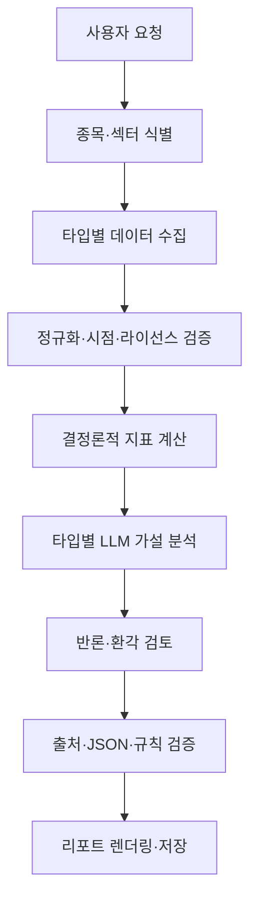

# 아키텍처 초안 (v0.2)

실제 공개 무료 서비스의 모듈/DB/잡 상태/비용 게이트 명세는 PUBLIC_ARCHITECTURE.md를 우선한다. 기존 그림은 논리 파이프라인을 표현한다. 공개 사용자는 FastAPI의 캐시 또는 비동기 작업 상태를 조회하며 모든 소스는 권리 검사를 통과해야 한다.

## 컴포넌트 경계

1. `InstrumentResolver`: ticker + exchange + identifier + asset/instrument type. 동명/심볼 변경/상장폐지/ADR를 고려.
2. `SourceAdapter`: SEC, 사용이 허가된 원천 거시 통계(BLS·BEA 등), 시세 벤더, 발행사 IR, 뉴스 등 외부 데이터 연결. FRED API 직접 연결은 보류. 소스별 rate limit와 약관.
3. `PointInTimeStore`: 원본/정규화 스냅샷과 공표시각, 갱신 이력; 과거 리포트 재현.
4. `MetricEngine`: 값 계산, 분모 유효성, 분할·배당 조정 여부, 회사/섹터/ETF별 계산 구분.
5. `ResearchEngine`: 분석 프롬프트, 도구 컨텍스트, 증거 ID, 모델 호출 추적.
6. `RiskCritic`: 부정적 증거, 비관 시나리오, 편향/리스크, 논리 모순 점검.
7. `ReportValidator`: 스키마/필수 출처/숫자 일치/신선도/공개 가능 여부의 **코드 기반** 검사.
8. `ReportAPI/UI`: 리포트·출처·조건부 시나리오와 생성 기록 표시.

## 처리 계약

- 모델에 전달하는 자료는 `evidence_id`, `title`, `url`, `published_at`, `retrieved_at`, `as_of`, `text` 등으로 구조화. 공개 텍스트는 항상 비신뢰 영역.
- 같은 작업의 모든 데이터는 `as_of` 컷오프를 공유; 추후 발표된 정보를 과거 분석에 끼워 넣지 않음.
- LLM은 원시 수치의 최종 결정권자가 아님. 계산 엔진이 만든 metric과 provenance를 참조해야 함.
- `validate` 실패 시 재작성 1회까지 허용; 실패 지속 시 부분 보고서/오류로 처리하고 성공으로 위장하지 않음.
- 추론의 불확실성과 데이터 부족을 UI에서 별도 표시.

## 권장 확장 순서

단일 프로세스/CLI → FastAPI + DB → 웹 UI → 캐시·비동기 잡 → 다중 모델 및 정기 작업. 초기에는 복잡한 에이전트 오케스트레이션을 도입하지 않는다. 품질과 비용 측정이 우선이다.
