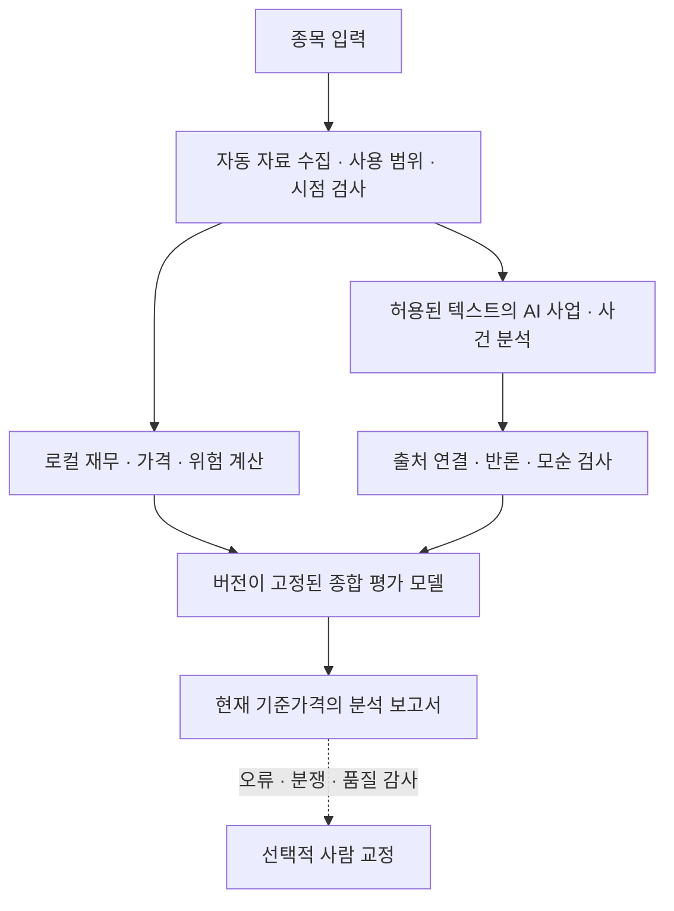
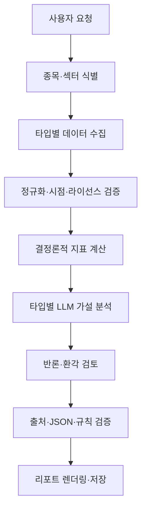

# 아키텍처 초안 (v0.3)

[AI 신뢰성·기업 노출·사건 평가](../reports/private/reliability_case/20261110/DEVELOPMENT_REPORT.ko.md)를 1→2→3 순서로 개발하고 각 검사·검토 이력을 남겼다. 신규 104개, 전체 1,223개 통과·1개 환경 건너뜀. 새 AI 후보는 메모리 부족으로 미실행이며, 기업별 직접 경제 노출과 실제 사건/가격 성능은 미확정이다. 기존 실패·23변수·가격 계수·최종 잠금·예약 5개와 추천/목표가 보류를 유지한다.

[기업별 조건부 영향·반론 연결](../extensions/ISSUER_IMPACT.md)을 별도로 구현했다. BE/MSFT/XOM의 SEC 숫자·허용 공식 문단·기존 뉴스 링크를 연결하고 실제 보고서 3건을 재생했다. 실제 로컬 모델 품질 시험이 고정 기준에 미달해 기업 보고서의 AI 채택은 보류한다. 주가 효과·추천 점수는 보류한다. 새 검사 41개, 전체 1,119개 통과·1개 환경 건너뜀. [결과와 재개 조건](../reports/private/impact_case/20261109/SUMMARY.ko.md).

요청형 뉴스 확장: ondemand_news(종목·N일·시각·부분 결과·보고서) → ondemand_transport(기존 공유 계정/GDELT 예산) 및 ondemand_cache(소유권·한도·캐시 정리). 임시 캐시와 사용 근거 사본을 분리해 정리 후에도 보고서를 재생한다. 기존 다섯 예약·가격/AI/검토 계약은 보존하고 상시 뉴스 작업을 추가하지 않는다. [설계](../extensions/ON_DEMAND_NEWS.md).

최신 확장: turnover_features(상대 거래대금 근사·지속성·가격 반응) → turnover_report(개인용 계산·한계 보고서), turnover_job → turnover_audit(원래 평가·원본 재생 완료 뒤 같은 계수의 세 후보 비교). 기존 가격 9변수 중 거래량 계수 2만 교체하고 23변수 엔진·가격 예측·기존 네 예약은 보존한다. 현재 뉴스 정량 영향과 기관 매수 인증은 보류다. [설계](../extensions/TURNOVER_RESEARCH.md).

최신 별도 확장: 허용 공식 문단 → local_inference(로컬 CPU Qwen3-4B) → semantic_research(분류·정확 인용·시각/출처 검사·반론 보고서). 기존 weighted_engine과 입력 계약은 변경하지 않는다. followup_job은 전체 기존 panel 완료 → panel_diagnostics 및 coefficient_audit(가격 9변수)의 제한적 후속 처리를 예약한다. 일반적인 기업 추론·독립 AI 반론 생성·뉴스 단기 가격 효과의 인증은 계속 후속 단계다. [설계](../extensions/AUTONOMOUS_RESEARCH.md), [검증 결과](../reports/private/autonomous_case/20261109/SUMMARY.ko.md).

[가중 엔진 v1](../extensions/WEIGHTED_ENGINE.md)은 weighted_features(숫자·미래 경로) → weighted_events(공식 문구·조건부 사업 경로) → weighted_critic(계수/근거/누락/위험) → weighted_report(개인용 연구 보고서)의 별도 구성이다. 23개 계수와 원래 입력을 고정하고 과거 모델·예약·보고서를 보존한다. 범용 AI 해석과 계수 실증 검증을 완료한 것으로 표시하지 않는다.

3·4·5단계 입력 기반을 완료했다. [공통 계약](../extensions/ANALYSIS_CONTRACT.md)이 재무 사실·공식 문단과 개인용 가격을 분리하고, [시장 입력](../extensions/MARKET_INPUTS.md)은 BE/MSFT/XOM 및 SPY/PBW/XLK/XLE의 식별·EOD·같은 거래일 비교를 제공한다. [재무 보완](../extensions/FINANCIAL_FILL.md)은 기존 검토를 유지하며 XOM의 영업매출 분류·합계 일치를 자동 확인한다. 이 입력을 소비하는 로컬 규칙 가중 엔진·반론 검사가 구현됐으며 범용 AI 사업/뉴스 추론과 계수 실증 검증은 후속 단계다. [모듈 연결 그림과 실제 결과](../reports/private/current_inputs_case/20261109/SUMMARY.ko.md).

## 2026-11-09 제품 목적과 다음 구현 우선순위

사용자가 종목을 입력하면 최신 확보 자료를 자동으로 수집하고, 현재 기준가격에서 약 5거래일 동안의 투자 매력도를 재무·가격·시장/업종·뉴스·위험 측면에서 분석해 보고서를 작성하는 것이 제품 목표다. 정상적인 보고서 생성에 사용자의 기사별 판단 입력이나 수동 승인 파일을 필수로 요구하지 않는다. 사람의 검토는 개발 중 정답 사례 작성·품질 감사·오류/분쟁 교정에 사용한다.

현재 수집·보관·수치 계산·검토 기록 검사·보고서 조합은 구현돼 있다. 로컬 규칙 가중 분석·조건부 사업 경로·반론 검사는 weighted_engine v1에 구현했다. 아래 범용 AI 사업/뉴스 해석과 자유 반론 생성은 후속 단계다. 검토 양식이나 저장 자료를 엮은 보고서가 이 자동 분석을 대신했다고 평가하지 않는다. 다음 개발의 주 경로는 이 누락된 분석 계층과 종합 평가 연결이다. 과거 성능 평가·BE 관찰·SEC 갱신의 기존 작업은 유지한다.

| 역할 | 수행할 처리 | 지켜야 할 구분 |
|---|---|---|
| 자동 분석 엔진 `ResearchEngine` | 허용된 원문에서 사실·사건을 추출하고 기업 관련성·사업 전달 경로·방향·기간·불확실성을 구조화 | 출처의 사실과 모델의 해석을 구분하고 근거 ID·공개/관측 시각·모델/프롬프트 버전을 기록 |
| 반론 검사 `RiskCritic` | 주장과 근거의 불일치·재보도·상반된 자료·장기 효과의 단기 오용·과도한 확신을 검사 | 다른 AI의 동의를 사실 인증으로 취급하지 않고 검사 가능한 출처·일자·수치는 코드로 대조 |
| 수치·종합 평가 | 로컬 가격 기회·위험·재무와 자동 해석의 검증된 특징을 정해 둔 규칙으로 결합 | LLM이 목표가·상승률·최종 점수를 임의 생성하지 않으며 근거 신뢰도와 투자 매력도를 구분 |
| 보고서 조합 | 확인된 사실·조건부 해석·반론·근거·부족한 항목을 자동 출력 | 일부 해석 실패는 그 항목의 보류로 표시하며 사람 입력을 기다리는 일반 사용자 흐름으로 바꾸지 않음 |
| 사람 검토 | 품질 평가용 사례, 예외 교정과 피드백 | 모델 출력이나 자동 검사 통과를 사람의 원문 확인 기록으로 위장하지 않음 |

다음 구현 순서는 (1) AI 사용이 허용된 텍스트 입력과 추론 실행/예산 계약, (2) 출처에 결합한 자동 사실·사건 분석, (3) 반론·근거 검사, (4) 기존 로컬 수치와 종합 보고서 연결, (5) BE 한 종목의 실제 자동 실행과 품질 평가다. 기존의 수동 검토 계약을 느슨하게 바꾸는 대신 별도 자동 분석 계약을 둔다. 본문·가격·공급자 메타데이터의 현재 권한을 추정해 외부 모델로 보내거나, 유료 서비스를 자동 활성화하지 않는다.

이 단계의 완료 기준은 **종목 입력 이후 사람의 해석 파일을 추가하지 않고 분석 보고서가 생성되는 것**이다. 실제 자료·근거 검사·부분 실패·반론·재현을 함께 확인해야 하며, 가상 예제의 성공만으로 실제 자동 분석 완료를 선언하지 않는다. 정식 목표가·매력도 제공은 모델 검증 조건을 유지하고, 미검증 항목을 표시한 자동 연구 보고서부터 연결한다. 자동 실행의 완성과 미래 수익 예측 성능은 별도로 검증한다.

사용자 지시의 독립 작업 1→2에 따라 [허용된 공식 원문 입력](../extensions/README.md)과 [공유 요청 큐](../extensions/API_QUEUE.md)를 별도 `extensions` 계층에 구현했다. 연준·EIA 자체 작성 문장을 본문·문단별 근거로 저장하고, 정책 내용·robots·제3자 자료·시점·해시를 검사한다. 가격과 일반 언론사 원문의 외부 AI 입력은 확대하지 않는다. 회사 뉴스의 새 큐는 기존 계정 잠금·예산 상태를 공유하며 기존 예약/계산 코드는 보존한다. AI가 읽을 수 있는 입력을 준비한 단계이고 자동 해석·반론 엔진 자체는 계속 미구현이다.

[기업별 뉴스 확장](CONTEXT_EXPANSION.md)은 기존 종합 계약을 보존하는 별도 구성 계층이다. SEC 식별에 결합한 기업 설정, 기업별 기사·검토 저장소, 계정 호출 제한을 공유하는 갱신기, 원문 검토 대기표와 확장 보고서를 제공한다. 전체 프로젝트 기준선으로 요청·저장·보고서 생성 전 충돌을 검사하며 새 자료를 기존 예측에 소급하지 않는다.

[종합 보고서](INTEGRATED_REPORT.md)는 기존 재무·가격·뉴스를 변경하지 않는 별도 구성 계층이다. 가격 입력은 사용권·원본 대조 후 최초 연결 시각을 가진 불변 사본으로 보관한다. 기업별 승인 프로파일과 공통 기준시각으로 재무·시장·업종·기사 버전 검토를 읽고, 부분 보고서·출처 목록·파일 묶음과 계산 재생을 제공한다. 기존 예측·관찰·학습·잠긴 최종 평가에는 입력하지 않는다.

[기간 연결](SEC_QOQ_TTM.md)은 기존 공시 목록에서 필요한 같은-CIK 원문만 별도 수집해 불변 묶음으로 저장한다. 기존 현재/연간 검토와 역할별 원문 구성요소를 연결하고, 별도 검토·산식·보고서가 QoQ/TTM을 제공한다. 기존 작업·계약은 수정하지 않으며 데이터 부족·기간/범위 충돌·원문 및 검토 변경은 보류한다.

[전년 비교 계층](SEC_GROWTH.md)은 기존 현재 실적 검토를 그대로 읽고, 같은 공시의 비교 열에 별도 검토 기록을 붙인다. 현재 검토·원문·기준시각이 맞을 때만 증감액·전년 대비·이익률 %p를 계산한다. 원문 검토 v1·가격/뉴스 모델·예약 작업은 변경하지 않는다.

[SEC 원문 검토 연결](SEC_FACT_REVIEW.md)은 저장 공시→inline-XBRL 증거→검토 수신 기록→다종목 공통 재무 입력→재무 근거 보고서의 별도 경로다. 검토한 항목만 계산·문장으로 전달하고 미해결·새 버전은 보류한다. 기존 자동 수집·BE 가격·과거 평가 작업을 변경하지 않는다.

별도 [다종목 SEC 갱신 모듈](SEC_AUTO_REFRESH.md)은 관심 목록→CIK 식별→제한된 공식 API→불변 원본·시점 기록→미검토 재무 정규화→읽기 전용 참고자료로 연결한다. 가격·뉴스의 고정 작업과 분리하고 현재 재무의 과거 평가 소급 투입을 차단한다. Windows 예약은 자체 코드·정책 해시와 공유 SEC 요청 잠금을 사용한다.

> 2026-11-07 현재 범위는 개인용 로컬 CLI다. 아래 공개 서버/API는 후속 설계로 보류한다. 개인 가격은 로컬 계산만 허용하며 외부 LLM으로 전달하지 않는다. 현재 연결·실행 기준은 MARKET_PREPARATION.md다.

실제 공개 무료 서비스의 모듈/DB/잡 상태/비용 게이트 명세는 PUBLIC_ARCHITECTURE.md를 우선한다. 기존 그림은 논리 파이프라인을 표현한다. 공개 사용자는 FastAPI의 캐시 또는 비동기 작업 상태를 조회하며 모든 소스는 권리 검사를 통과해야 한다.

## 컴포넌트 경계

1. `InstrumentResolver`: ticker + exchange + identifier + asset/instrument type. 동명/심볼 변경/상장폐지/ADR를 고려.
2. `SourceAdapter`: SEC, 사용이 허가된 원천 거시 통계(BLS·BEA 등), 시세 벤더, 발행사 IR, 뉴스 등 외부 데이터 연결. FRED API 직접 연결은 보류. 소스별 rate limit와 약관.
3. `PointInTimeStore`: 원본/정규화 스냅샷과 공표시각, 갱신 이력; 과거 리포트 재현.
4. `MetricEngine`: 값 계산, 분모 유효성, 분할·배당 조정 여부, 회사/섹터/ETF별 계산 구분. 스윙 프로필은 조건부 목표·무효화·손익비·거래일 기한을 계산하며 검증된 매력도 모델만 점수를 산출한다(향후 구현).
5. `ResearchEngine`: 분석 프롬프트, 도구 컨텍스트, 증거 ID, 모델 호출 추적.
6. `RiskCritic`: 부정적 증거, 비관 시나리오, 편향/리스크, 논리 모순 점검.
7. `ReportValidator`: 스키마/필수 출처/숫자 일치/신선도/공개 가능 여부의 **코드 기반** 검사.
8. `ReportAPI/UI`: 리포트·출처·조건부 시나리오와 생성 기록 표시.

## 처리 계약

- 모델에 전달하는 자료는 `evidence_id`, `title`, `url`, `published_at`, `retrieved_at`, `as_of`, `text` 등으로 구조화. 공개 텍스트는 항상 비신뢰 영역.
- 같은 작업의 모든 데이터는 `as_of` 컷오프를 공유; 추후 발표된 정보를 과거 분석에 끼워 넣지 않음.
- LLM은 원시 수치의 최종 결정권자가 아님. 계산 엔진이 만든 metric과 provenance를 참조해야 함.
- `validate` 실패 시 재작성 1회까지 허용; 실패 지속 시 부분 보고서/오류로 처리하고 성공으로 위장하지 않음.
- 추론의 불확실성과 데이터 부족을 UI에서 별도 표시.

## 권장 확장 순서

단일 프로세스/CLI → FastAPI + DB → 웹 UI → 캐시·비동기 잡 → 다중 모델 및 정기 작업. 초기에는 복잡한 에이전트 오케스트레이션을 도입하지 않는다. 품질과 비용 측정이 우선이다.

## 스윙 입력과 출력 (설계)

`REQUEST.horizon=swing`이면 서버가 사용권·신선도·시장 캘린더·계산방법을 확인하고 `SWING_INPUT`을 만든다. LLM은 계산한 가격·점수·시점을 전사하고 근거/반론/한줄평만 작성한다. 가격 계획·점수·도달기간은 독립적으로 보류할 수 있다. 모든 숫자는 snapshot/calculation/methodology 식별자를 보존하며 공개 전 결정론적 검증을 거친다. UI는 스윙 요약을 먼저, 기존 리서치를 그 아래 표시한다. 세부 상태·만료·캐시 계약은 SWING_REPORT_SPEC.md와 PUBLIC_ARCHITECTURE.md를 따른다.
