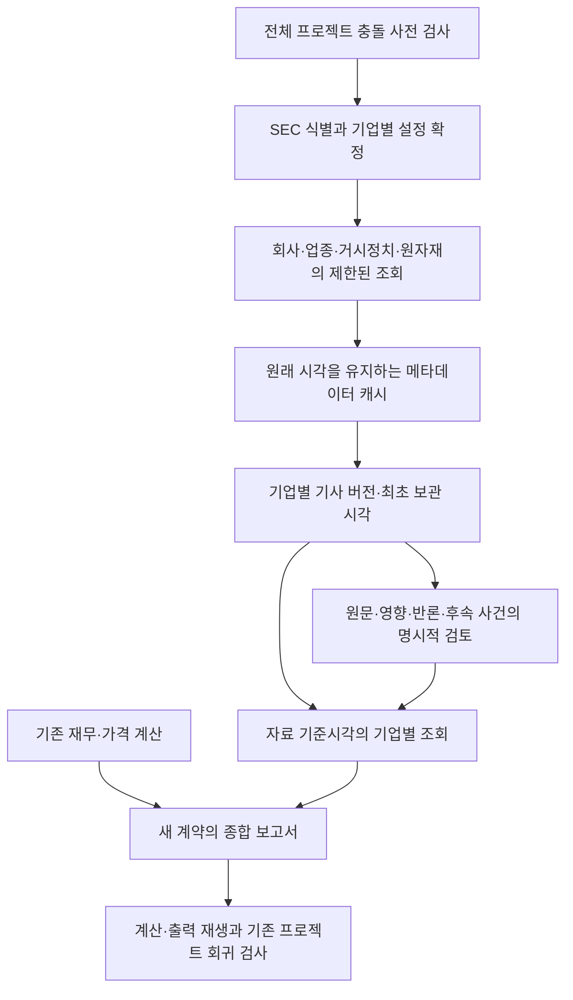

# 기업별 뉴스 갱신·원문 검토·확장 보고서

2026-11-09 후속 가격·재무 연결은 [market_inputs](../extensions/MARKET_INPUTS.md)와 [financial_fill](../extensions/FINANCIAL_FILL.md)의 별도 범위에서 완료했다. 기존 기업 프로파일·뉴스 정책·확장 보고서의 방법과 가격 지원 상태 값은 과거 기록 재생을 위해 보존한다. 새 입력 연결 보고서는 BE/MSFT/XOM의 주식·시장·업종 EOD를 지원하며 뉴스 자동 사업 해석은 다음 단계다. [실제 결과](../reports/private/current_inputs_case/20261109/SUMMARY.ko.md).

제품의 정상 흐름은 종목 입력 뒤 자동 분석·평가·보고서 생성이다. 이 문서의 수동 검토 양식·등록 기능은 현재 구현된 근거 보관·품질 검사 수단이며, 사용자가 매번 원문을 판독해야 하는 완제품 흐름을 뜻하지 않는다. 자동 사업/뉴스 해석·반론 엔진은 미구현이고 다음 개발의 주 항목이다. [자동 분석의 역할·구현 순서·완료 기준](ARCHITECTURE.md#2026-11-09-제품-목적과-다음-구현-우선순위)을 따른다. 아래 내용은 기존 버전의 실제 기능·사용 범위·이력으로 보존한다.

사용자 지시 1→2의 새 범위는 [공식 원문 입력](../extensions/README.md)과 [공유 요청 큐](../extensions/API_QUEUE.md)다. 기관 자체 작성 원문 4건·22문단을 별도 보관했으며 일반 언론사 본문과 가격의 외부 AI 권한은 확대하지 않았다. 현재 회사 뉴스 수집 명령은 `extensions.queued_news`다. 아래 원래 메타데이터 계약·코드와 그 과거 결과는 보존한다. [이번 실행 결과](../reports/private/source_access_case/20261109/SUMMARY.ko.md)에 수집·캐시·기존 자료와 작업의 보존 검사를 남긴다.

원래 전송 버전은 `context_adapters.news_refresh_v2`다. 최초 실제 실행에서 해제 후에도 남는 잠금 파일을 실행 중으로 판단한 v1 수집 검사를 확인했다. v2는 [Windows 바이트 잠금 규칙](https://learn.microsoft.com/en-us/windows/win32/fileio/locking-and-unlocking-byte-ranges-in-files)에 따라 비버퍼링 읽기로 실제 잠금을 확인한다. Windows 관찰 잠금을 새로 취득하거나 파일을 삭제하지 않는다. 같은 프로세스와 별도 프로세스의 실제 잠금/해제를 검사한다.

이미 저장한 v1 코드·보고서와 대기 결과는 보존한다. 수정 수집기는 별도 `context_adapters` 이름공간을 쓰고, 후속 기준선은 그 파일·테스트와 앞선 확장 보고서도 보호한다. 기존 보호 영역의 해시 검사에 어댑터 영역의 추가/변경 검사를 더하며, 이전 계산·보고서의 검증 규칙을 완화하지 않는다.

2026-11-09. 기존 재무·가격·뉴스 종합 보고서의 다음 단계다. BE·MSFT·XOM을 서로 다른 기업 식별번호(CIK)·검색 설정·보관 공간·영향 검토로 연결한다. 개인용 로컬·월 데이터 예산 $0이며 정식 목표가·매력도·수익실현 예상일은 기존 검증 대기를 유지한다.

같은 날 후속 실행에서는 거시경제·정치 검색 링크 25건과 공식 보완 3건을 새 부분 보고서 3건에 연결했다. 회사 뉴스는 공유 요청 잠금으로 대기했고 원자재/업종 검색도 확보하지 못했다. 기존 전송기를 바꾸지 않고 로컬 잠금 해제 기회만 제한적으로 기다리는 일회성 운영 도구를 사용했다. 신규 대기 검사 8개, 보호 파일 344개·이전 보고서 18건·예약 3건 검증과 반복 캐시 추가 HTTP 0회를 확인했다. 원문 영향 검토·강조 사건은 0건이며 자동 AI 판독·뉴스 사건별 가격 평가기는 아직 없다. [후속 실행·검토 방식·보고서](../reports/private/news_followup_case/20261109-attempt2/SUMMARY.ko.md)에 실제 결과와 남은 조건을 기록했다.

## 이번 단계가 해결하는 문제

| 문제 | 추가한 처리 |
|---|---|
| BE 전용 설정을 늘리면 이전 보고서의 방법 해시가 바뀜 | 이전 코드는 보존하고 별도 기업 설정·뉴스·보고서 계약을 추가 |
| 뉴스를 다시 조회해도 기사·검토가 보고서에 연결되지 않음 | 제한된 수집→원래 조회 시각을 가진 캐시→기업별 아카이브→원문 검토 양식→새 보고서 |
| 오래된 캐시·실패가 최신 확인이나 뉴스 부재로 보일 위험 | 성공·빈 검색·부분 결과·장애·대기를 구분하고 최초 조회 시각 유지 |
| 같은 기사라도 기업마다 사업 영향이 다름 | 기업·프로파일·기사 버전·최초 검토 수신 시각을 함께 결합 |
| 후속 개발이 기존 모델·예약 작업을 깨뜨릴 가능성 | 작업 전 기준선과 허용 변경 목록, 단계별 해시 검사, 기존 보고서 재생과 전체 회귀 검사 |



## 기업 설정과 지원 범위

`config/issuer_profiles.json`에 기업 식별번호, 뉴스 검색어, 시장·업종 참고 상품과 검토 시각을 기록한다. 저장된 SEC의 실제 기업 식별·operating 분류와 맞아야 최초 승인 기록을 저장할 수 있다. 기업·프로파일 자체에도 최초 이용 가능 시각이 있으며 같은 초의 저장 순서는 추정하지 않는다.

BE의 기존 시장/업종 가격 연결은 SPY·PBW다. MSFT의 정보기술 참고 상품은 [XLK 운용사 문서](https://www.ssga.com/us/en/intermediary/etfs/state-street-technology-select-sector-spdr-etf-xlk), XOM의 에너지 참고 상품은 [XLE 운용사 문서](https://www.ssga.com/us/en/institutional/etfs/state-street-energy-select-sector-spdr-etf-xle)를 대조했다. 이는 기업 전체 사업·주가를 대변하거나 매수를 추천하는 관계가 아니다. **MSFT·XOM의 새 가격·ETF 시세 어댑터는 이 단계에서 활성화하지 않았다.** 뉴스는 두 기업에도 별도로 연결한다.

XOM의 현재 CIK는 저장 SEC 식별의 `0002115436`을 사용한다. 전신 법인의 과거 재무를 합치거나 부족한 최근 12개월 계산을 임의로 채우지 않는다.

## 뉴스 갱신과 무료량

회사 뉴스는 [Massive의 티커 뉴스 API](https://massive.com/docs/rest/stocks/news?assetClass=stocks&license=personal&name=stocks_basic)를 사용한다. 공식 문서상 Basic을 포함한 주식 플랜에 포함되며 시간 단위로 갱신된다. 실시간·누락 없는 세계 뉴스로 설명하지 않는다. 한 번에 기업당 최대 25건, 최근 72시간, 회사 요청 최대 3회를 사용한다. 추가 페이지는 따라가지 않으며 페이지가 남으면 부분 결과로 표시한다.

기존 다종목 과거 평가기의 `local_data/historical_panel_api/request.lock`과 `budget.json`을 공유해 계정 호출 간격 15초·429 대기를 존중한다. 기존 작업의 코드·설정·진행 상태는 바꾸지 않는다. 로컬 캐시의 성공·실패 모두 15분 이내에는 실제 재호출하지 않으며 원래 조회/시도 시각을 유지한다.

과거 수집기가 공유 요청 잠금을 사용하는 동안에는 새 회사 뉴스 요청이 HTTP 호출 없이 대기할 수 있다. 대기 사유와 캐시 시각을 보존하고 잠금을 강제로 가져오지 않는다. `deferred`를 무료량 소진이나 유료 플랜 필요로 해석하지 않는다. 같은 실행의 반복 확인은 캐시 검사이며 실제 회사 뉴스 응답을 검증했다는 뜻이 아니다.

BE 예약 관찰 작업이 실행 잠금을 가진 동안에는 새 회사 뉴스 요청을 대기시켜 기존 관찰을 우선한다.

GDELT는 기존 공유 전송기의 제한·대기를 사용한다. 거시정치·원자재는 공유 검색, 업종은 기업별 검색이며 실행당 실제 호출 최대 5회다. 첫 실패·부분 결과·제한 응답 뒤에는 나머지 GDELT 요청을 미실행 대기로 남긴다. HTTP 429뿐 아니라 HTTP 200의 일반 텍스트 요청 제한도 성공한 빈 결과로 바꾸지 않는다.

연준·EIA 공식 RSS는 기존 제한된 보완 경로를 한 번 공유한다. 공식 피드 몇 건으로 일반 거시정치·원자재 검색 전체를 확인했다고 표시하지 않는다. 원자재 가격 수치를 제목으로 추정하지 않는다.

제목·주소·출판사·공급자의 날짜만 보관한다. 본문·요약·이미지·공급자 감정 판정은 버린다. 뉴스 원문 본문을 새로 수집하거나 외부 LLM으로 보내지 않는다. 새로운 학습·주문·전체 뉴스 점수는 실행하지 않는다.

## 원문 검토와 기간별 조회

`REVIEW_QUEUE.ko.md`는 원문 링크와 기업별 확인 질문을, `review_input.template.json`은 빈 검토 양식을 제공한다. 검토자 종류(사람/보조 도구)·ID, 원문 확인 시각·발행 확인, 기업의 5거래일에 미칠 영향, 호재·악재, 반론과 후속 사건을 명시해야 한다. 초안은 승인 기록이 아니다.

검토는 해당 기업의 기사 버전과 최초 보관 이후에 원문을 확인한 기록이어야 한다. 실제 수신 전에 과거 시각을 적어도 이용 가능 시각은 앞당겨지지 않는다. 동일 기사라도 다른 기업에 대한 검토는 별도로 제출한다. 프로파일 변경·기사 수정·A→B→A 되돌림·방법 변경·검토자 충돌·검토/메타데이터 만료는 강조 보류 사유다. 검토 기록은 검토자의 주장이고 코드가 원문의 진위를 독립 인증한 결과가 아니다.

조회는 기준시각 전의 기사 집합과 검토 수신 기록만 읽는다. 기준시각과 같은 초도 제외한다. 전체 실행 시각만 새롭다는 이유로 뉴스 최신성을 통과시키지 않는다. 실제 공급자·주제별 확인 시각을 다시 계산한다. 실패한 주제는 중립·안전으로 바꾸지 않는다.

## 프로젝트 충돌 검사

`project_compatibility.py`는 작업 전 파일 해시, 허용 수정/추가 경로, 원래 예측·근거·예약·보고서 목록을 읽는다. 기존 계산·정책·테스트·결과의 변경·삭제와 허용하지 않은 새 파일이 있으면 중단한다. 문서 수정 허용이 계산 파일 수정까지 허용하지 않는다.

갱신 시작·각 공급자 요청 전·보관 전·보고서 생성과 재생 시 검사를 적용한다. 도중에 기준선 또는 구현 방법이 바뀌어도 후속 요청·보관을 중단한다. `--replay`는 기존 예약 검증과 저장 보고서의 원래 계산·원본·출력 파일도 재생한다. `--checkpoint`는 검사 결과를 별도 기록으로 보존한다. 이 검사와 행동 테스트를 함께 사용하며, 해시 일치만으로 모든 회계 해석이나 미래 수익이 옳다고 판단하지 않는다.

현재 실행 기준선은 `reports/private/source_access_case/20261109/runtime.step2.json`이다. 이전 개발·실행 기준선도 보존한다. 이후 새 개발도 변경 범위를 선언한 별도 기준선으로 관리하며 이미 생성한 보고서의 방법·출처 검증 경로를 보존한다. 원문 과거 검증은 고정한 방법/출처를 확인하고, 현재 작업 검사는 추가 확장 경로의 허용 파일 목록도 확인한다.

검증 후 `--freeze <새-기준선.json>`을 사용하면 새 구현 파일까지 보호 대상으로 확정하고 추가 파일 허용 범위를 닫는다. 기존 개발 기준선은 보존한다. 실제 갱신과 보고서에는 이 확정 기준선을 사용한다.

## 실행과 저장

Stocker 가상환경에서 실행한다. 조회/수집과 보고서 생성은 분리한다.

```powershell
$baseline = 'reports/private/source_access_case/20261109/runtime.step2.json'
.\.venv\Scripts\python.exe -B -m extensions.queued_news --baseline $baseline --check --replay
.\.venv\Scripts\python.exe -B -m extensions.text_collect --baseline $baseline --collect
Start-Sleep -Seconds 1
.\.venv\Scripts\python.exe -B -m extensions.text_collect --baseline $baseline --packet
.\.venv\Scripts\python.exe -B -m extensions.queued_news --baseline $baseline --ciks 1664703 789019 2115436
.\.venv\Scripts\python.exe -B -m research.expanded_report --baseline $baseline --ciks 1664703 789019 2115436
```

갱신은 기존 본인의 무료 계정 확인 기록과 `MASSIVE_API_KEY`를 사용한다. 키 값은 출력하지 않는다. 보고서 생성·검토 등록·과거 조회는 새 API 요청을 하지 않는다. 이 수집기는 한 번 실행하는 CLI이며 기존 예약은 유지한다.

v2의 `runtime_baseline.json`은 개발 검증 후 다음 명령으로 한 번 확정한다. 이미 확정한 기준선은 덮어쓰지 않고 위 실행에서 재사용한다. 기존 v1 기준선도 그대로 둔다.

```powershell
.\.venv\Scripts\python.exe -B -m context_adapters.news_refresh_v2 --baseline reports/private/news_expansion_case/20261109-lockfix/baseline.json --check --replay --freeze reports/private/news_expansion_case/20261109-lockfix/runtime_baseline.json
```

```powershell
.\.venv\Scripts\python.exe -B -m research.issuer_news --baseline $baseline --context <기업별-context.json> --import-review <완료한-검토.json>
.\.venv\Scripts\python.exe -B -m research.expanded_report --baseline $baseline --ciks 1664703 --as-of '2026-11-09T00:00:00Z'
.\.venv\Scripts\python.exe -B -m research.expanded_report --validate <새-보고서/report.json>
.\.venv\Scripts\python.exe -B -m research.issuer_context_demo
```

저장 위치는 모두 개인용이다.

- `issuer_profiles/real/receipts/`: SEC 식별과 결합한 기업 설정의 최초 승인 기록.
- `news_refresh/real/<실행>/<CIK>/`: 수집 근거, 원문 검토 대기표·초안.
- `issuer_news/real/<CIK>/archive/real/`: 기업별 기사 버전·보관 시각.
- `issuer_news/real/<CIK>/reviews/`: 기업·기사·프로파일에 결합한 변경 불가 검토 수신 기록.
- `expanded_reports/real/<CIK>/<보고서>/`: 종합 Markdown·전체 JSON·기존 계약의 구성요소 JSON·영역별 상세·파일 해시 묶음.

위 경로는 `reports/private/` 아래다. 가상 자료는 별도의 `illustrative/` 영역과 가상 표기를 사용한다. 표준 출력에는 상태·건수·경로만 표시하며 가격·수익·기사 제목·검토 문안을 출력하지 않는다.

새 보고서 계약은 `issuer-expanded-research-v1`이다. 원래 `integrated-research-report-v1` 구성요소는 그대로 포함하고 별도 뉴스 계층을 원문 링크·기간·보류 사유와 함께 표시한다. 과거 예측을 뉴스 포함 예측으로 바꾸거나 실증 결과를 소급 튜닝하지 않는다.

검사는 `tests/test_project_compatibility.py`, `tests/test_news_refresh.py`, `tests/test_issuer_context.py`와 가상 골든 계약으로 수행한다. 다음은 실제 원문 영향 검토와 부족한 검색 범위 보완, MSFT·XOM 등의 별도 가격·ETF 어댑터, 기존 다종목 과거 평가와 BE 예약 관찰의 실증 성능 확인이다.

전체 회귀 명령은 `.\.venv\Scripts\python.exe -B -m pytest -q tests context_adapters/tests extensions/tests --disable-warnings`다. v2 잠금과 새 원문·요청 큐 검사도 함께 실행한다.

## 실제 실행 결과

2026-11-09 전체 검사 762개를 통과하고 실제 BE/MSFT/XOM 확장 보고서 3건을 생성했다. 보호 파일 304개, 이전 보고서 15건과 기존 예약 3건을 검증했다. 새 보고서도 나중의 캐시 기록 이후 다시 재생했다. [결과와 보류 이유](../reports/private/news_expansion_case/20261109-lockfix/SUMMARY.ko.md)에 새 보고서·검토 대기표·수집 근거를 연결했다.

수정 실행의 회사 뉴스는 과거자료 수집기의 공유 요청 잠금 때문에 0회, GDELT는 실제 1회 뒤 대기, 공식 RSS는 2회 요청했다. 즉시 반복 확인은 모든 공급자 0회로 캐시를 재사용했다. 각 기업에 실린 공식 보완 기사 3건은 서로 같은 기사이며 원문 영향 검토·강조 사건은 0건이다. 회사 뉴스의 실제 응답 확보, 넓은 업종·거시·원자재 확인과 원문 검토는 아직 남아 있다. 가격·미래 성능·뉴스 점수를 승인한 결과가 아니다.

## 원문 영향 검토와 발표 후 주가 평가는 서로 다른 기록이다

현재 구현된 것은 **검토자가 원문을 읽고 사업 영향을 입력하면 프로그램이 출처·시각·누락·충돌을 검사하는 방식**이다. 뉴스 내용을 자동으로 읽고 판단하는 AI나 발표 후 수익률을 이용한 자동 호재/악재 분류기는 아직 없다. 빈 검토 양식과 입력 검사 기능이 있다는 사실을 실제 기사 검토 완료로 표현하지 않는다. 기업별 BE/MSFT/XOM 연결은 [CONTEXT_EXPANSION.md](CONTEXT_EXPANSION.md)를 따른다.

| 구분 | 원문·사업 영향 검토 | 발표 후 시장 반응 평가 |
|---|---|---|
| 질문 | 당시 알려진 새 사실이 이 기업에 어떤 경로로 영향을 줄 수 있는가? | 그 판단 이후 실제 가격은 어떻게 움직였고 시장·업종 흐름과 얼마나 달랐는가? |
| 자료 | 원문·확인된 공개 시각·그때 이용 가능했던 공시/사업 정보 | 정해 둔 관찰기간 이후 확보한 적법한 가격·시장/업종 비교 자료 |
| 결과 | 방향·중요도·관련성·근거·반론·후속 확인 사건의 검토 기록 | 가격 반응·비교 기준 대비 차이·고점/하락과 도달기간의 사후 측정 |
| 현재 구현 | 양식·수신 기록·기업/기사 버전 연결·일관성 검사 | 뉴스 사건별 평가기는 미구현. 기존 가격 예측 관찰과도 구분 |
| 금지하는 혼합 | 나중에 올랐다는 이유로 과거 기사를 호재로 고쳐 쓰기 | 사후 결과를 당시 이미 알았던 뉴스 특징이나 예측으로 넣기 |

원문 검토는 다음 순서로 수행한다.

1. 원문 주소·발행 주체·최초 공개 시각을 확인한다. 재보도·의견·예정·확정 발표와 중요한 후속 업데이트를 구분한다. 검색기가 처음 발견한 시각을 발표 시각으로 대신하지 않는다.
2. 확인된 사실과 해석을 나눈다. 예를 들어 수주는 계약 확정 여부·조건·취소 가능성·매출 반영 시기를 확인해야 하며, 수주라는 단어만으로 단기 호재를 확정하지 않는다. 이는 가상 설명이며 실제 기업 사건을 판정한 예가 아니다.
3. 해당 기업의 매출·원가·자금 조달·규제·수요 중 어떤 경로와 연결되는지 설명한다. 사업 영향이 있어도 수개월 뒤 반영된다면 약 5거래일 판단의 근거로 쓸 이유를 별도로 적는다.
4. 긍정·부정·혼재/영향 없음의 방향과 크기, 관련성·근거 수준을 기록한다. 확인이 부족하면 임의로 중립이나 작은 호재를 넣지 않고 검토 대기로 남긴다. 현재 가중치는 검토자가 정한 연구용 등급이며 실증으로 학습한 상승 확률이 아니다.
5. 이미 알려진 사실인지, 반대 해석은 무엇인지, 무엇을 확인하면 판단을 바꿀지 기록한다. 검토자·기사 버전·확인/수신 시각을 보존하고 유효한 새 보고서에서만 사용한다.

주가가 이미 반응했는지는 이후 남아 있는 거래 기회를 판단할 때 중요할 수 있다. 다만 사업에 좋은 사실이라는 판단과 지금 가격에서 추가 상승 여력이 있다는 판단은 별개다. 현재 뉴스 검토 계약에는 ‘선반영 정도’의 자동 수치 모델이 없고 이를 임의로 추정해 점수에 넣지 않는다. 앞으로 이 정보를 확장해도 보고서 기준시각까지 실제 관측할 수 있었던 가격 반응만 판단 입력으로 쓴다.

발표 후 변동폭을 보는 것은 **사건 연구(event study)**에 해당하는 별도 검증 경로다. 원문 검토를 먼저 고정하고, 제안 관찰기간인 1·3·5거래일의 가격 반응과 시장·업종 비교, 최대 상승/하락·고점 도달기간을 나중에 비교하는 방향이다. 기간·비교 기준·장중/장후 발표 처리·거래 비용·누락 처리와 표본 조건은 실제 평가 전에 별도 확정해야 한다. 일봉만으로 장중 발표 직전 가격이나 변화의 정확한 선후를 복원하지 않는다.

[MacKinlay의 사건 연구 방법론](https://www.bu.edu/econ/files/2011/01/MacKinlay-1996-Event-Studies-in-Economics-and-Finance.pdf)은 관측 수익률과 정상적으로 기대되는 수익률의 차이를 분석한다. 시장·업종도 함께 움직이거나 여러 발표가 겹칠 수 있으므로, 발표 이후 올랐다는 사실만으로 해당 기사가 상승 원인이었다고 단정하지 않는다. 이 구분은 이번 문서 설명이며 사건 연구 코드·실데이터 학습·뉴스 점수 가중치 변경을 구현했다는 뜻이 아니다.

