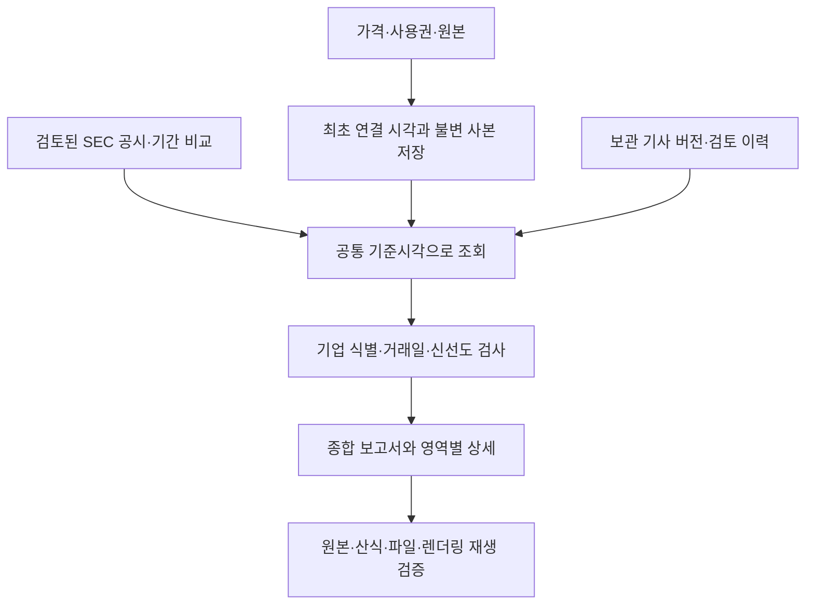

# 재무·가격 시나리오·뉴스의 종합 보고서

2026-11-09 후속 [가중 엔진](../extensions/WEIGHTED_ENGINE.md)은 검증된 공통 입력에 기존 5거래일 모형·23개 계수·로컬 사건 규칙·반론/위험 검사를 연결하는 별도 연구 보고서다. 원래 integrated/expanded/analysis 계약과 파일을 변경하지 않는다. 실제 세 종목에 실행했으며 뉴스 판독/수집과 일부 재무 부족을 표시하고 정식 점수·가격 계획은 보류한다. [생성 결과](../reports/private/weighted_engine_case/20261109/SUMMARY.ko.md).

2026-11-09 후속 3→4→5단계는 기존 종합 보고서를 보존하는 별도 [공통 분석 입력](../extensions/ANALYSIS_CONTRACT.md) 경로다. 새 경로에서 BE/MSFT/XOM과 각 시장·업종 ETF의 현재 EOD를 연결하고 XOM 영업매출 1개를 보완했다. 원래 research.integrated_report의 가격 지원 범위를 바꾸거나 새 예측을 생성하지 않는다. 최종 보고서는 analysis_contract 입력 연결 보고서이며 AI 자동 해석은 미실행이다. [세 기업 최종 보고서와 한계](../reports/private/current_inputs_case/20261109/SUMMARY.ko.md).

후속 [기업별 뉴스 확장](CONTEXT_EXPANSION.md)은 이 계약의 코드·입력·기존 결과를 보존하고 별도 기업 설정·메타데이터 갱신·검토·보고서 계약으로 MSFT·XOM 등의 뉴스 연결을 제공한다. 아래 원래 BE 전용 범위와 과거 실행 결과는 유지한다.

2026-11-09 구현. 원문 검토를 마친 재무, 현재 확보한 종가의 5거래일 연구 시나리오, 기사 버전에 연결된 검토를 같은 자료 기준시각(`as_of`)에서 읽는다. 개인용 로컬·월 데이터 예산 $0이다. API 요청·외부 LLM API·학습·주문은 0회다.

| 영역 | 평가 질문 | 사용하는 기존 계층 |
|---|---|---|
| 기업 실적 | 매출·손익·현금흐름과 비교 기간은 어떤가? | SEC 현재·연간 원문 검토, 전년 대비·전분기·최근 12개월 |
| 가격 연구 | 5거래일의 조건부 고점 구간·목표 후보·비용·위험은 어떤가? | 개인용 가격 원본 대조, 고정 EWMA 통계 시뮬레이션, 비용 필터 |
| 시장·업종 | 같은 거래일의 관련 ETF는 어떤 흐름인가? | 기업별로 승인한 SPY·PBW 연결과 원본 대조 |
| 뉴스 | 같은 기사 버전에 유효한 영향 검토가 있는가? | 뉴스 보관 이력과 최초 수신 시각을 가진 검토 연결 |

전년 대비(YoY)는 같은 기간의 작년 값과, 전분기 대비(QoQ)는 바로 전 분기와 비교한다. 최근 12개월(TTM)은 직전 연간+올해 누적−전년 같은 누적이다. EPS·귀속 범위·정정본의 제한은 기존 재무 계층에서 유지한다.



## 모듈과 지원 범위

`integrated_inputs.py`는 가격·ETF·사용권을 먼저 검사하고 별도 사본을 저장한다. `integrated_report.py`는 기존 계산을 호출해 조합하고, `integrated_report_render.py`는 질문·단위·기간·보류 사유를 설명한다. 기존 수집기·수식·정책·검토 기록·예약 작업은 변경하지 않는다.

종합 연결은 재무·뉴스를 가격 모형의 새 입력으로 학습하지 않는다. 정식 목표가·매력도·예상 수익실현 시기·검증 ID는 `null`이며 전체 추천 준비 상태는 미완료다. 별도로 표시한 연구 목표 후보와 비용 조건을 검증된 투자 추천으로 해석하지 않는다. 시뮬레이션 경로를 실제 관측 거래 수로 세지 않는다.

가격·업종·뉴스의 초기 연결은 **BE의 검토된 프로파일**만 지원한다. 실제 BE CIK는 `0001664703`이고 SPY는 시장, PBW는 폭넓은 청정에너지 참고 ETF다. MSFT·XOM 등은 검토된 재무를 유지하고 해당 영역의 부족 사유를 표시한다. 다른 기업에 BE 가격·PBW·BE 뉴스를 적용하지 않는다. 가상 BE는 별도 CIK `0000001001`과 가상 분류를 사용한다.

종합 기업 보고서는 저장한 SEC 기업 식별과 operating 분류를 요구한다. 기업 식별이 없거나 펀드 등 다른 유형이면 이 기업 재무 계약으로 분석하지 않는다. ETF는 기업 대신 승인된 시장·업종의 참고 역할로만 연결한다.

## 시점과 재생

가격의 원래 조회 시각과 종합 보고서용 최초 연결 시각을 구분한다. 기본 명령은 저장된 최신 입력을 선택하되 사용권 확인 전에 가격을 읽지 않는다. 원본과 정규화 결과를 대조한 사본을 만든 뒤 실제 마지막 저장 시각을 기록한다. 같은 입력 재연결은 시각을 갱신하지 않는다. A→B→A 되돌림은 새 순서·시각을 받는다.

서로 다른 저장소에서 기준시각과 같은 초에 저장된 자료는 순서를 추정하지 않고 제외한다. 뉴스도 기준 초 이전의 기사 집합을 먼저 고정한 뒤 원래 기준시각에 검토·사건·메타데이터 최신성을 검사한다. 나중 기사나 검토가 과거 보고서의 출처·개수·판정을 바꾸지 않는다.

새 입력이 부적합하면 해당 영역을 보류하고 과거의 정상 입력으로 조용히 되돌아가지 않는다. 보관 사본이 훼손되면 검증에 실패한다. 원래 파일이 바뀌어도 이미 보관한 보고서의 사본과 시각은 유지한다. 해시는 로컬 변경 탐지 수단이며 독립된 시각 인증이나 사용권 진위의 증명은 아니다.

가격은 최근 완료 정규장 세션·USD·조정 기준·EOD를 검사한다. ETF는 검토된 기업별 역할과 같은 기준 거래일을 요구한다. 오래된 가격에서 현재 목표 후보를 내지 않는다. 보고서 만료와 5거래일 관찰 종료 시각도 구분한다.

뉴스의 긍정·부정 사건은 같은 조건으로 강조한다. 미검토·변경·되돌림·충돌·만료는 보류한다. 공식 피드나 회사 기사 몇 건으로 업종·세계 정치·원자재 전체 검색이 확인됐다고 판단하지 않는다. 원자재 가격을 제목에서 추정하지 않는다. 본문 수집·자동 영향 AI는 추가하지 않는다.

## 실행

Stocker 가상환경에서 실행한다. API 키나 새 네트워크 연결이 필요 없다.

```powershell
.\.venv\Scripts\python.exe -B -m research.integrated_report --ciks 1664703 789019 2115436
.\.venv\Scripts\python.exe -B -m research.integrated_report --ciks 1664703 --as-of '2026-11-09T00:00:00Z'
.\.venv\Scripts\python.exe -B -m research.integrated_report --validate reports/private/integrated_reports/real/<CIK>/<id>/report.json
.\.venv\Scripts\python.exe -B -m research.integrated_report_demo
```

기본 명령은 입력 사본을 연결한 뒤 공통 기준시각을 정한다. `--as-of`는 읽기 전용이며 새 입력을 보관하거나 과거로 시각을 소급하지 않는다. 최초 연결 전 시각에는 가격 영역을 보류한다. 과거 값을 현재 계획으로 재사용하는 옵션은 제공하지 않는다.

`--input-root`, `--news-root`, `--archive-root`로 보관 저장소를 지정할 수 있다. SEC는 기존 검토·소스 계약을 사용한다. `--output`의 실제 자료 경로는 `reports/private/` 아래만 허용한다.

## 저장 내용

- 입력: `reports/private/integrated_inputs/real/<CIK>/packets/<id>/`에 역할별 가격·권한·원본 사본과 묶음 해시. `receipts/`에는 최초 이용 시각을 가진 변경 불가 수신 기록.
- 종합 보고서: `reports/private/integrated_reports/real/<CIK>/<id>/REPORT.ko.md`, 전체 근거·계산·방법 해시를 포함한 `report.json`.
- 상세: `CURRENT.ko.md`, `YOY.ko.md`, `FINANCIAL.ko.md`, 뉴스가 연결되면 `NEWS.ko.md`.
- `bundle.json`: 파일 해시. 검증 CLI는 JSON 계산과 파일 변경·주 보고서 렌더링 일치를 확인한다.
- 가상 예제는 별도 `illustrative/` 영역이다. 실제 데이터 승인·학습에 쓰지 않는다.

표준 출력은 상태·건수·경로만 표시하고 가격·수익·기사 제목·검토 문안은 개인용 파일에 남긴다. 이전 사전 예측·관찰 결과를 등록·정산·수정하지 않으며 과거 평가의 잠긴 최종 구간도 읽지 않는다.

## 검증 범위

`tests/test_integrated_report.py`는 전체·부분 연결, 기업 식별·상품·통화·EOD·사용권·세션 불일치, 최초 저장/동일 초/되돌림, 변조·원본 변경·미래 기록 배제, 뉴스 충돌·만료, 정식 점수 차단, 파일 묶음·렌더링 재생과 기존 기록 비변경을 확인한다. 골든 계약은 `examples/integrated_report_golden.json`이다.

이 검사는 프로그램 연결과 재현성을 확인한다. 실제 미래 수익은 별도의 다종목 과거 평가와 동결된 BE 예약 관찰에서 검증한다. 다음 확장은 기업별 프로파일, 실제 최신 뉴스 원문·영향 검토와 자료 갱신, 충분한 실증 결과를 바탕으로 한 모델 평가다.

방법·계약·기업 프로파일을 바꾸는 후속 작업은 버전과 실행을 구분하고 기존 보고서의 방법 해시·원본 검증 경로를 보존해야 한다.

2026-11-09 실제 적용: BE/MSFT/XOM 종합 보고서 3건과 기존 보고서 9건의 재생을 확인했다. BE는 재무 18/18·전년 15·QoQ/TTM 각각 5개, 가격 연구·ETF 2개·뉴스 4건을 연결했다. 보관 뉴스의 최신성과 원문·영향 검토가 부족해 강조 사건은 0건이다. 다른 기업의 가격·뉴스는 BE와 섞지 않고 미지원으로 표시한다. 전체 자동 검사 705개(신규 46개) 통과, 예약 3건 무결성 및 기존 예측·근거 파일 불변, 새 API·외부 LLM·학습 0회. [로컬 결과 해설](../reports/private/integrated_case/20261109/SUMMARY.ko.md), [감사 기록](../reports/private/integrated_case/20261109/RESULTS.json).
