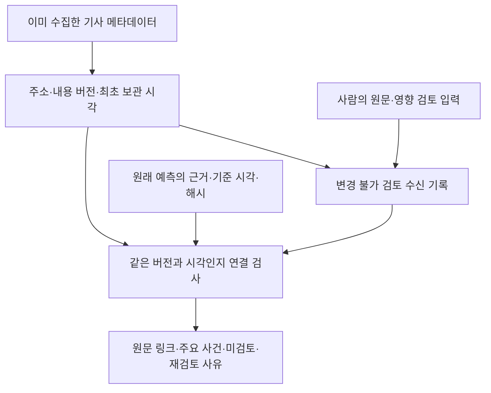

# 기사 버전·검토·예측 기록의 연결

후속 [기업별 뉴스 경로](CONTEXT_EXPANSION.md)는 이 BE 전용 계약을 유지하고 별도 CIK·프로파일에 결합한 기사·검토 저장소를 사용한다. 기존 검토를 다른 기업에 재결합하지 않으며 새 자료는 새 확장 보고서에 표시한다.

2026-11-08 개인용 로컬 연결 모듈을 추가했다. 이미 저장한 뉴스 메타데이터, 사람이 작성한 원문·사업 영향 검토, 기존 예측의 자료 기준 시각을 연결한다. 새 기사를 크롤링하거나 기사 본문을 AI로 판독하지 않는다. 현재 원문 검토 계약이 BE용이므로 이 버전의 대상 종목도 BE다.



## 저장하는 것과 재사용 기준

기사 자료는 기존 `news_archive`의 제목·URL·출처·공급자 표기 발행 시각만 사용한다. 새 연결 모듈은 원문 본문·언론사 요약·이미지·공급자 감정값을 저장하지 않는다. 검토자의 근거·약 5거래일 관련성·반론·후속 확인 사건은 사람이 작성한 별도 판단으로 보존한다.

검토는 `news_event_review.schema.json`의 기존 입력 형식과 `event_review.assess`의 출처·발행 시각·검토 순서 검사를 통과해야 한다. 초안, 빈 검토, 다른 뉴스 묶음의 해시, 검증하지 않은 발행 시각, 잘못된 원문 링크, 미래 검토 시각은 저장하지 않는다. 검토가 유효해도 일반 업종·거시/정치·원자재 검색이 부족하면 그 사실을 계속 남긴다.

수신 기록에는 원본 검토 양식의 복사본, 원래 뉴스 묶음, 기사 버전 연결, 실제 최초 저장 시각, 저장 순서, 입력/정책/기존 검증 코드의 해시를 보존한다. 원래 입력 파일이 나중에 바뀌어도 과거 수신 기록을 덮어쓰지 않는다. 같은 입력을 다시 가져오면 최초 수신 기록을 재사용하고 가용 시각을 새로 만들지 않는다.

| 상황 | 연결 처리 |
|---|---|
| 같은 주소·같은 메타데이터를 재조회 | 이전 검토가 유효기간 안이면 설명용으로 연결 |
| 제목·출처·발행 표기가 달라짐 | 다른 버전으로 보고 재검토 필요 |
| A→B→A로 되돌아옴 | 연속된 버전 구간이 달라졌으므로 오래된 A 검토를 자동 부활시키지 않음 |
| 새 기사가 한 건 추가됨 | 이전 기사들의 변경 없는 검토는 유지하고 새 기사는 검토 대기로 표시 |
| 같은 검토자가 같은 사건의 새 판단을 저장 | 새 수신 이후 조회부터 최신 판단을 사용. 이전 시점 조회는 이전 판단 유지 |
| 서로 다른 검토자가 방향·영향 등을 다르게 판단 | 충돌을 보존하고 그 사건의 주요 뉴스 강조 보류 |
| 사건이 여러 기사를 인용 | 모든 기사 버전이 맞아야 연결 가능 |
| 검토/원문 확인 후 24시간 초과 | 메타데이터를 새로 받아도 검토 시각은 유지하며 재검토 필요 |
| 재보도·미검증 근거·오래되거나 조회가 오래된 자료 | 기록은 유지하되 최신 주요 사건 강조 조건은 충족하지 못함 |

메타데이터가 같다는 사실은 원문 본문까지 같다는 증명이 아니다. 검토 역시 사람이 확인했다고 입력한 주장이고 프로그램이 독립적으로 진위를 보증하지 않는다. 의미상 같은 사건인지는 검토자가 사건 ID를 일관되게 부여해야 한다.

## 예측에 연결하는 방식

예측 파일, 원래 근거 파일, 기초 가격 예측의 해시·종목·실제/가상 분류를 확인한다. 자료 기준 시각은 원래 예측의 `as_of`로 고정하며 명령에서 다른 시각을 지정할 수 없다. 원래 근거에 없던 기사나 다른 버전을 뒤늦게 붙이지 않는다. 다중 출처 사건은 모든 인용 기사가 당시 근거에 포함돼야 한다.

기사 아카이브와 검토 저장소는 공통 순서 번호가 없으므로 예측과 같은 초에 저장된 자료를 먼저 있었던 것으로 추정하지 않는다. 예측 연결은 해당 초 전체를 제외한 이전 기록만 사용한다. 나중에 같은 초의 자료가 추가돼도 기존 예측 연결의 내용·파일 ID가 달라지지 않도록 한다.

일부 초기 실제 BE 기록에는 최상단 `as_of`와 근거의 분류 필드가 없다. 이 경우에만 기존 관찰 예약 작업에 고정된 정확한 대상/원본 해시를 확인한 뒤, 해시가 연결된 원래 근거 파일의 선언된 `as_of`와 원래 실제/가상 분류를 읽는다. 가격 화면의 시각 ≤ 근거 시각 ≤ 기록 시각 < 다음 거래 시작도 확인한다. 증거가 없으면 기록 생성 시각이나 현재 시각으로 추정하지 않고 보류한다. 명시된 가상 분류를 실제로 바꾸지도 않는다.

연결 결과는 **사후 자료 가용성 점검**이다. 당시 어떤 검토를 참고할 수 있었는지와 실제 원래 판단에 그 검토가 사용됐다는 주장은 구분한다. 현재 기존 예측은 가격·비용만의 기록이며, 연결이 원래 가격 계획·행동·관찰 결과를 바꾸지 않는다. 앞으로 뉴스가 실제 판단에 사용되는 새 전진 실험은 별도 후보와 등록 절차가 필요하다.

## 주요 사건 강조와 점수

같은 버전/시각으로 연결된 검토 중 중간·높은 영향, 확인된 근거, 새 사건/검토한 중요 업데이트, 최근 사건과 최근 메타데이터라는 조건을 만족한 항목을 강조한다. 긍정과 부정 사건을 같은 조건으로 표시하고 원문 링크·근거·반론·후속 관찰을 함께 보여준다.

이번 연결은 설명용이다. 전체 뉴스 묶음 해시에 연결된 기존 점수 검사를 새 묶음에 맞게 자동 재작성하지 않는다. 기존 signed freshness 산식과 가격·매력도 엔진도 바꾸지 않는다. 실험 뉴스 총점·추천 점수·상승 확률은 모두 비워 둔다. 연결 성공이 수익 예측력 개선을 입증하지 않는다.

## 실행 순서

모든 명령은 Stocker 가상환경에서 실행하며 새 네트워크 요청·API 키 읽기·외부 AI 호출은 없다. 새로운 기사 수집 자체는 기존 별도 수집 명령의 역할이다.

```powershell
# 이미 저장한 근거의 뉴스 메타데이터를 보관하고 검토 양식/대기표 생성
.\.venv\Scripts\python.exe -B -m research.news_connections --capture $contextFile

# 원문을 확인해 별도 저장한 검토 양식을 최초 수신 시각과 함께 등록
.\.venv\Scripts\python.exe -B -m research.news_connections --import-review $reviewFile --context $contextFile

# 현재 보관 버전과 검토를 연결해 보고서 생성
.\.venv\Scripts\python.exe -B -m research.news_connections

# 그 시점까지 저장된 자료만 조회
.\.venv\Scripts\python.exe -B -m research.news_connections --as-of '2026-11-08T11:30:00Z'

# 원본 예측의 시각·근거를 고정한 별도 연결 문서 생성
.\.venv\Scripts\python.exe -B -m research.news_connections --forecast $forecastFile

# 실제 뉴스가 아닌 양방향 영향·변경·되돌림·불변성 예제
.\.venv\Scripts\python.exe -B -m research.news_connections --demo
```

검토 등록 전에 원래 뉴스 묶음이 보관돼 있어야 한다. 오래된 검토를 등록한다고 그 입력을 다시 최신 아카이브로 수집하지 않는다. 이로써 나중에 들어온 원본 입력이 더 최신의 버전을 과거 내용으로 되돌리는 것을 막는다.

원문 확인 시각도 현재 연속 버전의 최초 보관 시각보다 나중 초여야 한다. A→B→A 이후 오래된 A 검토 파일을 다시 등록해도 새 버전 구간에 대한 원문 재확인을 대신할 수 없다. 이전 확인 시각 그대로면 저장을 거절한다.

`--capture` 결과 폴더의 `review_input.template.json`은 승인되지 않은 빈 양식이다. 원문과 발행 시각, 사업 영향·반론·후속 사건을 확인한 검토자만 채운다. 양식에는 정확한 원래 뉴스 묶음 해시가 들어 있으므로 임의의 다른 근거와 섞지 않는다. 실제/가상 자료는 `--illustrative`와 분류 필드가 일치해야 한다.

## 저장 위치

- 기사 원본 메타데이터/버전은 기존 `reports/private/news_archive/real/`에 유지한다.
- 검토 수신 기록은 `reports/private/news_connections/real/reviews/<수신ID>.json`에 추가한다.
- 예측 연결은 `real/forecasts/<예측ID>/<연결ID>.json`에 별도로 저장한다. 같은 연결은 기존 파일을 재사용한다.
- 조회별 `real/views/<UTC시각>/`에 `connections.json`, `provenance.json`, `REPORT.ko.md`를 저장한다. 기사/검토/근거의 ID·해시와 기준 시각을 추적할 수 있다.
- 가상 자료는 각각 `illustrative/` 영역으로 분리한다. 예제의 가상 예측에는 실제 가격을 넣지 않는다.

현재는 PC 로컬 JSON 저장소다. 서버 DB·웹 서비스·정기 수집은 이 모듈에 추가하지 않았다. 표준 출력에는 상태·건수·결과 위치만 쓰고 기사 제목·검토 내용·개인 가격/수익을 출력하지 않는다. 본문의 저장·외부 AI 이용·학습 권리를 보관이나 연결만으로 부여하지 않는다.

정책은 `config/news_connection_policy.json`, 계약은 `schemas/news_connections.schema.json`이다. 입력·원본/정책 해시·분류·시각·초안·충돌·변경/되돌림·만료·다중 출처·기존 예측 불변성은 `tests/test_news_connections.py`에서 확인한다. 기존 BE 예약과 대규모 평가기의 고정 파일은 변경하지 않는다.

## 2026-11-08 실행 확인

- 전체 프로그램 검사 **409개 통과**, 이 중 새 연결 검사 37개다. 구간 계산 등 기존 의존 라이브러리의 날짜 배열 경고는 남아 있으나 실패는 없다.
- 가상 기사 2건과 긍정/부정 검토를 연결해 주요 사건 2건을 표시했다. 한 기사의 버전이 바뀐 뒤에는 1건만 강조했고, 원래 제목으로 되돌아와도 과거 검토를 되살리지 않았다. 오래된 검토 파일 재등록으로 재확인을 우회하는 경우도 거절했다. [가상 연결 예제](../reports/private/news_connection_demo/20261108T115322124048Z/connections/illustrative/views/20261108T115322238636Z/REPORT.ko.md).
- 실제 보관 기사 4건은 모두 원문·영향 검토 대기로 표시했다. 같은 저장 입력의 재사용으로 아카이브 최초 시각을 갱신하지 않았으며 검토 양식과 대기표도 생성했다. [실제 보관 자료 연결 보고서](../reports/private/news_connections/real/views/20261108T115322142771Z/REPORT.ko.md).
- 기존 BE 예측의 원래 근거에는 기사 1건이 있다. 당시 아카이브의 보관 버전으로 확인되지 않아 검토 연결을 보류했다. 그 시점에 기사가 없었다거나 뉴스가 중립이었다는 판정은 아니다. 원래 예측과 근거의 해시는 유지했다. [기존 예측의 별도 점검](../reports/private/news_connections/real/views/20261108T115322276660Z/REPORT.ko.md).
- 새 기능의 API 요청·외부 AI 호출·학습은 모두 0회다. 실제 검토를 완료했거나 뉴스가 수익 예측을 개선했다고 주장하지 않는다.
