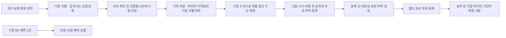
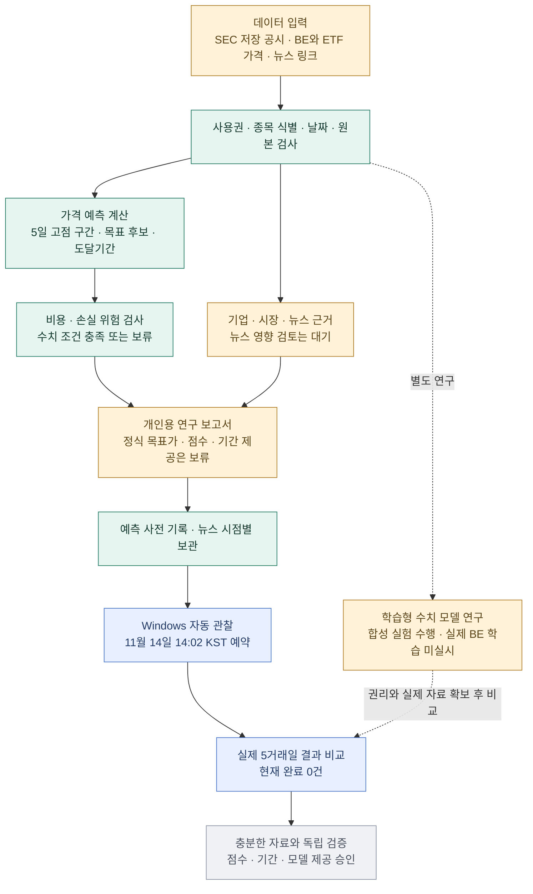

# 전체 모듈과 현재 개발 단계

[RAM 확보 후 실제 Qwen 재검증](../reports/private/critic_resume/20261110/851d20a11d064565b91184fbd55f4bee/SUMMARY.ko.md)을 완료했다. 기존 36개 입력·정답·프롬프트·기준을 유지했고 실제 모델 호출 36회, 기존 회귀 5/12, 새 모델 눈가림 합성 2/24, 잘못된 원시 승인 1건으로 quality_gate_failed 판정이다. 기존 미실행·실패 보고서는 당시 기록으로 보존한다. 독립 실제 사건·가격 예측력은 여전히 미검증이며 투자 점수·목표가는 보류한다.

[AI 신뢰성·기업 노출·사건 평가](../reports/private/reliability_case/20261110/DEVELOPMENT_REPORT.ko.md)를 1→2→3 순서로 개발하고 각 검사·검토 이력을 남겼다. 신규 104개, 전체 1,223개 통과·1개 환경 건너뜀. 새 AI 후보는 메모리 부족으로 미실행이며, 기업별 직접 경제 노출과 실제 사건/가격 성능은 미확정이다. 기존 실패·23변수·가격 계수·최종 잠금·예약 5개와 추천/목표가 보류를 유지한다.

[기업별 조건부 영향·반론 연결](../extensions/ISSUER_IMPACT.md)을 별도로 구현했다. BE/MSFT/XOM의 SEC 숫자·허용 공식 문단·기존 뉴스 링크를 연결하고 실제 보고서 3건을 재생했다. 실제 로컬 모델 품질 시험이 고정 기준에 미달해 기업 보고서의 AI 채택은 보류한다. 주가 효과·추천 점수는 보류한다. 새 검사 41개, 전체 1,119개 통과·1개 환경 건너뜀. [결과와 재개 조건](../reports/private/impact_case/20261109/SUMMARY.ko.md).

요청형 뉴스 조회·짧은 재사용·시각 보존·저장 상한·독립 근거 사본을 구현했다. 최종 전체 1,078개 검사 통과·1개 Windows 환경 건너뜀, 실제 4개 보고서 재생과 같은 요청 HTTP 0회를 확인했다. 회사 링크는 확보했고 GDELT의 429 범위는 대기로 남긴다. 기존 다섯 예약과 실험 계수·최종 기업/기간 잠금은 유지한다. [최신 결과와 실행](../reports/private/on_demand_case/20261109/SUMMARY.ko.md).

거래대금 근사·지속성 후보 모듈과 실제 BE/MSFT/XOM 보고서를 추가했다. 새 34개·전체 1,046개 검사, 이전 보고서·예약 정의 재생을 확인했다. 같은 계수에서 원래 거래량과 새 후보를 비교하는 15분 예약을 추가했으며 기존 원본 재생 완료를 기다린다. 계산 성공을 예측력·뉴스 영향·기관 매수 인증으로 표시하지 않는다. [최신 진행·자동 작업 상태](../reports/private/turnover_case/20261109/SUMMARY.ko.md).

중단 지점부터 재개하여 기존 보호 파일 563개·보고서 24건·가중 보고서 3건·예약 3건의 무결성을 확인하고 공통 입력 9건을 재검사했다. 제한된 공식 원문의 로컬 AI 판독과 세 종목 보고서, 전체 1,012개 코드 검사를 완료했다. 전체 과거 평가 완료 뒤 결과 해석·가격 9개 변수 계수 관련성을 계산하는 창 없는 5분 예약을 추가했다. 수익 예측 성능·전체 23변수 검증·정식 점수는 미완료다. [실제 결과와 현재 상태 링크](../reports/private/autonomous_case/20261109/SUMMARY.ko.md).

2026-11-09 가중 엔진 1차: [weighted_engine](../extensions/WEIGHTED_ENGINE.md)이 23개 계수별 가감점, 기존 5거래일 미래 경로·비용/위험, 재무·시장 계산과 공식 문구의 조건부 사업 경로·반론 검사를 자동 실행한다. BE/MSFT/XOM 연구 보고서 3건을 생성·재생했다. 전체 969개 검사, 이전 보고서 24건·공통 입력 9건·예약 3건 검증을 통과했다. 최신 사건 40점 축의 수집/판독 근거와 XOM 영업손익은 부족해 종합 지수는 보류한다. 현재의 사업 해석은 로컬 고정 규칙이며 범용 AI·계수 실증 검증·정식 추천도는 후속 단계다. [실제 결과](../reports/private/weighted_engine_case/20261109/SUMMARY.ko.md).

2026-11-09 독립 작업 3→4→5 완료: [공통 분석 계약](../extensions/ANALYSIS_CONTRACT.md), [다종목 종가·시장·업종 입력](../extensions/MARKET_INPUTS.md), [기업별 재무 누락 보완](../extensions/FINANCIAL_FILL.md)을 별도 구현했다. BE/MSFT/XOM과 ETF 4개에 각 480개 일봉을 연결했고, XOM 영업매출을 원문 분류·합계 대조로 보완했다. 재무는 BE 18/18·MSFT 18/18·XOM 8/9이며 XOM 영업손익·동일 CIK 연간 이력 공백은 보류한다. 전체 검사 911개, 이전 보고서 24건·공통 입력 6건·공식 문서 4건·예약 3건과 새 최종 입력 3건의 재생을 확인했다. AI 입력과 로컬 가격은 분리하며 자동 해석 엔진·정식 목표가·매력도 제공은 다음 단계다. [개발 결과와 최종 보고서](../reports/private/current_inputs_case/20261109/SUMMARY.ko.md).

2026-11-09 독립 작업 1→2 완료: [공식 원문 입력](../extensions/README.md)에서 연준·EIA 자체 작성 자료 각 2건, 총 4건·22문단을 실제 저장하고 인용 가능한 분석 입력 파일을 생성했다. 이어 [공유 요청 큐](../extensions/API_QUEUE.md)를 추가해 기존 계정 잠금·간격·429 대기를 유지하면서 회사 뉴스 HTTP 3회를 실행했다. BE 회사 링크 5개, MSFT 25개(추가 페이지로 부분 결과), XOM 최근 72시간 제한 검색 결과 0개다. 공식 보완을 포함한 새 부분 보고서 3건을 생성·재생했고 반복 조회는 모든 공급자 0회였다. 전체 검사 813개, 보호 파일 399개·이전 보고서 21건·예약 3건과 첫 원문 입력 보존 검증을 통과했다. 큐 우선순위는 새 협력 경로에 적용되고 기존 과거 작업은 원래 코드로 같은 잠금을 공유한다. 일반 언론사 본문·세계/업종 뉴스 전체 확보와 자동 사업/뉴스 해석 엔진은 여전히 남아 있다. [실제 결과·입력·보고서](../reports/private/source_access_case/20261109/SUMMARY.ko.md).

2026-11-09 제품 목적 대조: 현재는 자동 리서치 제품을 위한 수집·계산·검토 기록·보고서 조합 기반이 구현된 상태다. 종목만 입력해 사업·뉴스 영향을 새로 해석하고 반론을 작성하는 자동 분석 엔진은 아직 없으며, 수동 검토를 필수로 두는 흐름은 목표 제품의 완료 조건을 충족하지 못한다. 다음 주 개발 항목은 [허용 텍스트 입력·자동 분석·반론 검사·종합 평가 연결](ARCHITECTURE.md#2026-11-09-제품-목적과-다음-구현-우선순위)이다. 사람 검토는 품질 감사·예외 교정으로 둔다. 이전 수집/보고서 성과와 기존 예약 작업은 보존하며 이번 목적 대조가 자동 분석의 구현·원문 사용권·정식 점수 제공을 완료했다는 뜻은 아니다.

2026-11-09 뉴스 후속 실행: 거시경제·정치 검색이 응답해 링크 25건을 확보하고 공식 보완 3건과 함께 BE/MSFT/XOM의 새 부분 보고서 3건에 연결했다. 세 기업에 실린 링크를 합쳐도 주소 중복 제거 결과는 28건이다. 회사 뉴스는 기업당 45초의 로컬 잠금 대기 이후에도 공유 계정 요청 잠금을 확보하지 못했으며, 원자재/업종도 대기 상태다. 신규 대기 동작 검사 8개, 보호 파일 344개·이전 보고서 18건·예약 3건 검증을 통과했다. 직전 전체 회귀 762개 기록은 별도로 보존했다. 실제 원문 영향 검토·강조 사건은 0건이다. 현재는 검토자가 당시 사업 영향·반론을 입력하면 프로그램이 검사하는 단계이며, 자동 AI 판독이나 뉴스 사건별 사후 주가 평가기는 미구현이다. [실행 결과와 새 보고서](../reports/private/news_followup_case/20261109-attempt2/SUMMARY.ko.md), [원문 검토와 사후 평가의 구분](CONTEXT_EXPANSION.md#원문-영향-검토와-발표-후-주가-평가는-서로-다른-기록이다). 다음은 공유 API 동시 사용 조정·미확보 주제 보완과 실제 원문 검토이며 정식 점수·예측 성능 승인은 별도로 유지한다.

2026-11-09 기업별 뉴스 확장: [뉴스 갱신·검토·확장 보고서](CONTEXT_EXPANSION.md)를 별도 계층으로 구현했다. SEC 식별과 연결한 BE/MSFT/XOM 설정, 호출 제한을 공유하는 수집·캐시, 기업별 기사 버전·원문 검토 양식과 실제 보고서 3건을 확인했다. 해제 후 남는 관찰 잠금 파일을 실행 중으로 잘못 판단한 검사는 별도 전송 어댑터로 수정하고 실제 프로세스 잠금/해제를 검사했다. 전체 762개 검사(이번 57개), 보호 파일 304개·이전 보고서 15건 재생·예약 3건 무결성 확인을 통과했다. 실제 회사 뉴스는 실행 중인 과거자료 수집기의 공유 요청 잠금 때문에 HTTP 요청 없이 대기했고 GDELT는 1회 요청 후 대기했다. 각 기업에는 동일한 공식 보완 링크 3건만 연결됐고 영향 검토·강조 사건은 0건이다. 반복 확인의 새 API 호출은 0회다. 최신 세계 뉴스 확인이나 예측 수익성 완료를 뜻하지 않는다. [실제 결과·보류 사유·보고서](../reports/private/news_expansion_case/20261109-lockfix/SUMMARY.ko.md). 다음은 계정 요청 가능 시 회사 뉴스 응답 확인과 실패 주제 보완·원문 영향 검토, 이후 MSFT/XOM 가격 연결이며 정식 목표가·매력도 승인은 별도 검증을 유지한다.

2026-11-09 종합 연결 완료: [재무·가격·뉴스 보고서](INTEGRATED_REPORT.md)를 별도 구현해 실제 BE/MSFT/XOM 3건을 생성했다. BE는 재무 18/18·전년 비교 15·전분기/최근 12개월 각각 5개, 가격 연구·ETF 2개·보관 뉴스 4건을 같은 기준시각에 연결했다. 뉴스는 최신성·원문/영향 검토가 부족해 주요 검토 사건 0건으로 표시한다. MSFT/XOM은 재무를 유지하고 BE 전용 가격·업종·뉴스 혼입을 차단했다. 전체 705개 검사(신규 46개), 새 3건·기존 9건 재생, 예약 3건 무결성과 기존 예측/근거 파일 불변을 확인했다. 새 API·외부 LLM·학습 0회. [결과 해설](../reports/private/integrated_case/20261109/SUMMARY.ko.md). 다음은 최신 뉴스 원문·영향 검토와 기업별 가격/업종/뉴스 설정 확대이며, 실증 성능·정식 목표가·매력도 승인은 별도로 유지한다.

2026-11-09 기간 연결 완료: [전분기·최근 12개월 계층](SEC_QOQ_TTM.md)을 추가하고 실제 BE/MSFT의 매출·영업손익·순손익·영업현금흐름·유형자산 현금 지출을 각각 5개씩 계산했다. 누적 현금흐름 차감, 다른 회계연도의 연말 4분기, 정정본 선택 수치의 일치 여부를 확인했다. XOM은 동일 CIK의 연간 이력 부족으로 보류했다. 전체 테스트 659개(신규 55개), 새 보고서 3건·이전 보고서 6건의 재생과 기존 예약 3건의 무결성 검사를 통과했다. 보완 SEC 요청 4회, 보고서 생성 추가 요청·외부 LLM API 0회. [실제 결과와 해석](../reports/private/sec_chain_case/20261109/SUMMARY.ko.md). 다음은 기업 이력·잔액의 남은 공백 보완과 검토된 재무·가격·뉴스의 종합 보고서 조합이며, 예측 수익성 검증·목표가·매력도 승인은 별도로 유지한다.

2026-11-09 연간·전년 비교: [성장률 분석 계층](SEC_GROWTH.md)을 별도 구현했다. 미검토 MSFT 연간 9개를 추가하고 BE/MSFT/XOM의 전년 비교 34쌍을 대조해 보고서 3건을 생성·재생했다. 적자/0 기준 백분율은 보류하고 증감액·손익 전환·이익률 %p를 표시한다. 전체 604개 테스트(신규 50개), 기존 검토·보고서·예약 무결성 유지. 분기 동일일자 잔액·XOM 항목 정의 공백과 QoQ/TTM은 남아 있으며 예측 수익성 승인을 뜻하지 않는다.

2026-11-08~09 원문 검토 연결: [검토 기록→공통 재무 입력→다종목 재무 보고서](SEC_FACT_REVIEW.md)를 구현했다. 보조 도구의 실제 원문 대조 4건으로 BE 18개, MSFT 9개, XOM 7개 항목을 보고서에 연결했다. 미해결·미검토는 보류하고, 원문·기간·귀속 범위·검토 시각을 추적한다. 전체 테스트 554개(신규 64개), 실제 보고서 3건 재생 성공. 기존 자동 수집·가격 작업과 목표가/매력도 보류는 유지한다. 다음은 미검토 연간·비교 기간과 기업별 항목 정의를 확장하는 단계이며, 재무 입력이 예측을 개선하는지는 별도 모델 평가 대상이다.

2026-11-08 독립 개발: [다종목 SEC 자동 갱신](SEC_AUTO_REFRESH.md)을 구현하고 BE·MSFT·XOM 실제 수집을 확인했다. 기업 식별·공시 목록·표준 재무·원문 캐시·수정 이력·시점 조회·별도 예약 실행을 제공한다. 자동 추출은 미검토이며 일반 종목 투자 보고서 연결과 재무 의미의 원문 대조가 다음 단계다. 전체 산업 표본이나 실제 예측 성능의 완료를 뜻하지 않는다.

SEC 전용 예약 `Stocker-SEC-Refresh-0800956935094918`은 15분 간격으로 등록했고 실제 실행 종료 코드 0을 확인했다. 현재 관심 목록은 BE/MSFT/XOM이다. 전체 자동 검사 490개(SEC 신규 81개) 통과, 실제 최초 요청 15회·캐시 반복 0회. 대규모 종목 확대는 관심 목록 또는 확정된 과거 평가 기업의 CIK 가져오기로 수행한다.

2026-11-08 갱신: 모델 개발의 주 경로는 산업군당 서로 다른 기업 최소 100개의 과거 평가로 전환했다. 일반 종목 가격 어댑터·FF12 SIC 분류·기업 선정·중단 재개 작업·다종목 평가기가 구현됐다. 실제 BE 66개 기준일의 실행 경로 확인을 마쳤다. 이는 산업별 예측 성능 검증 완료를 뜻하지 않는다. BE 예약 관찰은 보조로 유지한다. [과거 평가 기준](HISTORICAL_EVALUATION.md), [실행과 실제 진행 수 확인](HISTORICAL_PANEL_RUNBOOK.md)을 우선하며, 아래 기존 표는 11월 7일의 모듈 현황이다.

수집·계산 코드는 구현됐으며 실제 대량 처리 진도는 작업 폴더의 `STATUS.ko.md`와 `progress.json`에서 확인한다. 마지막 시험은 자동 작업에 포함하지 않는다. 뉴스·재무 모듈은 유지하지만 현재 정보를 과거 가격 평가에 소급해서 넣지 않는다.

독립 개발로 [평가 결과 해석 도구](PANEL_DIAGNOSTICS.md)를 추가했다. 기존 계산/수집 코드를 바꾸지 않고, 완료된 기준일별 결과의 비교 성적·기간 묶음 불확실성·누락·월 의존성을 해석한다. 가상 계산과 BE 읽기 경로는 실행 가능하며 대규모 실제 성적은 수집·평가 완료 이후다.

2026-11-07 확인 기준. 현재 범위는 **개인용·월 데이터 예산 $0·BE 중심·약 5거래일 스윙 연구**다. 단계는 **Phase 1B의 연구 시제품 연결 후 실제 성능 검증 준비**다. 저장 공시와 가격을 읽고 계산·보고서·사전 기록을 만드는 경로는 동작하며, 정식 목표가·매력도·수익 실현 시기의 제공 승인은 남아 있다.

아래의 ‘동작 확인’은 프로그램 기능에 대한 표시다. 미래 수익성이 입증됐다는 표시가 아니다. 전체 완료율은 임의의 백분율로 환산하지 않는다.

## 모듈별 역할과 남은 일

| 모듈 | 무엇을 하는가 | 현재 상태 | 남은 조건 |
|---|---|---|---|
| 01. 입력·사용권 관리 | 쓸 수 있는 자료와 종목·날짜를 확인한다. | 현재 개인용 범위의 검사 동작 | 공개 배포·실가격 ML 학습은 별도 권리 미확인 |
| 02. SEC·기업 실적 | 매출·이익·현금흐름과 원문 근거를 연결한다. | 저장해 검토한 BE 공시로 보고서 생성 | 자동 SEC/XBRL 수집·최신 공시 확인·다종목 확장 |
| 03. 가격·시장·업종 | BE와 미국 시장/청정에너지 ETF의 마감 가격을 연결한다. | BE·SPY·PBW 연결 동작 | 여러 종목 확대와 기업행동·수정 이력 검토 |
| 04. 단기 고점·기간 계산 | 앞으로 5거래일의 가능한 가격 흐름으로 고점 구간·목표·시기를 추정한다. | 기본 고정 통계 엔진 구현 | 실제 고점·목표 우선 도달·시기 성능 검증 |
| 05. 비용·위험 판단 | 거래 비용 후 이익이 손실 위험에 비해 충분한지 검사한다. | 필터 동작, 최근 BE 수치 조건은 보류 | 실제 조건 통과/보류의 성과 누적·비교 |
| 06. 뉴스 수집·영향 검토 | 새 사건의 사업 영향과 관련성·반론을 확인한다. | 회사 링크 1건·EIA 링크 3건 연결, 검토 입력 기능 구현 | 실제 검토 0건. 일반 업종·거시경제/정치·원자재 검색 미완료 |
| 07. 시점별 기록·보관 | 미래에 바뀐 정보를 과거 판단에 섞지 않도록 한다. | 예측 사전 기록·기사 내용 버전·과거 조회 동작 | 검토된 사건 이력과 보관 자료 연결·지속 누적 |
| 08. 검증·자동 관찰 | 예상과 실제 가격·비용 후 가상 손익을 비교한다. | 합성·회귀 검사와 예약 실행 동작 | 실제 관찰 0건. 충분한 독립 사례와 시장 상황별 검증 |
| 09. 보고서·수치 검사 | 근거·단위·보류 이유를 한국어 문서로 만든다. | 개인용 CLI·Markdown·JSON 출력 동작 | 검증된 전체 점수 연결. 현재 정식 수치 제공은 보류 |
| 10. 학습형 모델 연구 | 과거의 특징과 미래 결과 관계를 학습해 기존 엔진과 비교한다. | 합성 데이터 학습·민감도·표본 검토 수행 | 실제 BE 학습권·충분한 표본·분리 평가 미완료 |
| 11. 제품 화면·서비스 | 조회·설정·과거 보고서를 화면으로 관리한다. | 후속 단계 | 개인용 화면, 운영 안정화. 공개 서비스는 현재 범위에서 보류 |

현재 기본 엔진은 과거 자료에서 변화폭 등을 계산해 **미래의 가능한 경로를 추정하는 통계 예측기**다. 별도 학습형 모델은 연구 도구이며 아직 실제 BE 자료로 학습하지 않았다. LLM 분석·반론 생성 파이프라인도 실행 중인 기능이 아니다. 프로그램의 외부 LLM 호출은 0이다.

주요 파일 묶음:

- 입력·실적: `rights.py`, `fetch_prices.py`, `fetch_context.py`, `sec_report.py`.
- 예측·판단: `peak_simulation.py`, `peak_model.py`, `trade_screen.py`, `trade_readiness.py`.
- 뉴스·보관: `news.py`, `massive_news.py`, `official_news.py`, `event_review.py`, `news_archive.py`.
- 기록·검증: `validation.py`, `peak_research.py`, `context_journal.py`, `observe.py`, `outcome_report.py`.
- 보고서: `context_report.py`, `evidence_context.py`, `report_language.py`.
- 학습·실험: `learned_peak.py`, `learned_research.py`, `robustness.py`, `sample_audit.py`, `trade_evaluation.py`.

## 지금 확인된 사실

- 자동 관찰 작업 Ready, 다음 실행 **2026-11-14 14:02 한국 시간**. 실제 스케줄러 시험 종료 코드 0·가격 API 요청 0회를 확인했다.
- 대상은 미리 저장한 첫 예측이다. 실제 계좌 주문을 실행하지 않으며 아직 결과도 없다. PC가 켜져 있고 해당 Windows 사용자가 로그인한 상태가 필요하다.
- 뉴스 메타데이터 4건을 보관했다. 실제 사건의 BE 영향 검토는 0건이다. 직전 GDELT 재조회는 요청 제한이었으며 이 현황 확인에서 새 뉴스 요청을 하지 않았다.
- 전체 프로그램 검사 310개 통과 기록이 있다. 동작 검사는 실제 투자 수익성 검증과 구분한다.
- 합성 표본 확대의 불확실성은 남아 있다. 다음 연구 진행을 승인받았다는 사실이 해당 표본 검토를 통과로 바꾸지는 않는다.

## 다음 단계의 순서

1. **지금 진행 가능:** 원문·사업 영향·반론을 확인한 뉴스 사건 이력을 저장하고 시점별 보관과 연결한다. 미확인 뉴스 주제도 보완한다. 자동 공시 갱신도 독립 모듈로 준비할 수 있다.
2. **관찰 전 정할 일:** 가격만 쓰는 모형과 검토한 뉴스를 추가한 모형의 비교 기준을 고정한다. 같은 사례·거래 비용·자료 시점을 사용하고, 결과를 본 뒤 유리하게 기준을 바꾸지 않는다. 실제 ML 학습권과 무료 자료의 표본 확보는 함께 검토한다.
3. **11월 14일 이후:** 예약 작업의 첫 결과에서 예상 고점·형성일·목표 우선 도달·비용 후 가상 손익을 읽는다. 첫 한 건은 검증 완료가 아니다.
4. **그다음:** 다른 시기·시장 상황·허용된 종목으로 사례를 누적한다. 같은 기간 단순 보유보다 나은지, 손실·오차·보류가 어떤 조건에서 커지는지 확인한다.
5. **제품 확장과 수치 승인:** 개인용 화면·자동 공시 갱신은 수치 보류 상태를 유지하며 병행 개발할 수 있다. 정식 목표가·기간·매력도 제공은 검증 기준 충족 후 단계적으로 승인한다. 종목 확장은 식별·사용권·검사 범위를 먼저 마련하며 공개 서비스는 별도 후속 결정이다.

2026-11-08 후속: **기사 버전·검토 수신 이력·원본 예측의 시점별 연결**을 별도 모듈로 구현했다. 설명용 검토 재사용과 주요 사건·원문 링크, 변경/되돌림·충돌·만료·뒤늦은 검토의 보류를 지원한다. 현재 실제 보관 자료는 원문 검토 대기로 남기며 자동 AI 판독·전체 뉴스 점수·수익 예측 개선은 미완료다. [사용법과 범위](NEWS_CONNECTIONS.md). 자동 관찰과 다종목 작업의 고정 파일은 유지한다.

상세: [자동 관찰](BACKGROUND_OBSERVATION.md), [뉴스 보관](NEWS_ARCHIVE.md), [뉴스 검토](NEWS_EVENT_REVIEW.md), [고점 모형](PEAK_MODEL.md), [학습형 모형](LEARNED_PEAK_MODEL.md).
