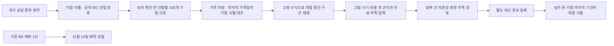
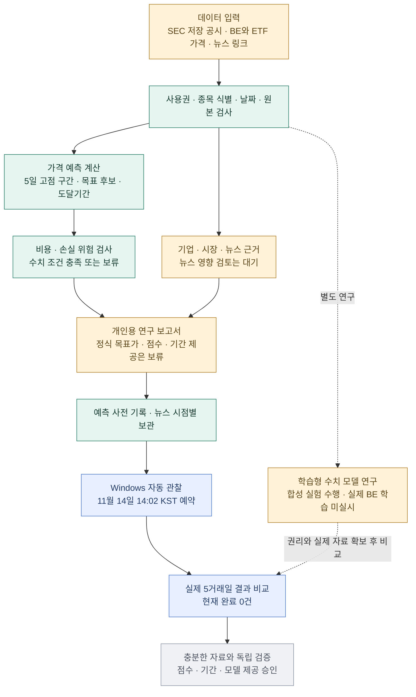

# 전체 모듈과 현재 개발 단계

2026-11-08 갱신: 모델 개발의 주 경로는 산업군당 서로 다른 기업 최소 100개의 과거 평가로 전환했다. 일반 종목 가격 어댑터·FF12 SIC 분류·기업 선정·중단 재개 작업·다종목 평가기가 구현됐다. 실제 BE 66개 기준일의 실행 경로 확인을 마쳤다. 이는 산업별 예측 성능 검증 완료를 뜻하지 않는다. BE 예약 관찰은 보조로 유지한다. [과거 평가 기준](HISTORICAL_EVALUATION.md), [실행과 실제 진행 수 확인](HISTORICAL_PANEL_RUNBOOK.md)을 우선하며, 아래 기존 표는 11월 7일의 모듈 현황이다.

수집·계산 코드는 구현됐으며 실제 대량 처리 진도는 작업 폴더의 `STATUS.ko.md`와 `progress.json`에서 확인한다. 마지막 시험은 자동 작업에 포함하지 않는다. 뉴스·재무 모듈은 유지하지만 현재 정보를 과거 가격 평가에 소급해서 넣지 않는다.

2026-11-07 확인 기준. 현재 범위는 **개인용·월 데이터 예산 $0·BE 중심·약 5거래일 스윙 연구**다. 단계는 **Phase 1B의 연구 시제품 연결 후 실제 성능 검증 준비**다. 저장 공시와 가격을 읽고 계산·보고서·사전 기록을 만드는 경로는 동작하며, 정식 목표가·매력도·수익 실현 시기의 제공 승인은 남아 있다.

아래의 ‘동작 확인’은 프로그램 기능에 대한 표시다. 미래 수익성이 입증됐다는 표시가 아니다. 전체 완료율은 임의의 백분율로 환산하지 않는다.

## 모듈별 역할과 남은 일

| 모듈 | 무엇을 하는가 | 현재 상태 | 남은 조건 |
|---|---|---|---|
| 01. 입력·사용권 관리 | 쓸 수 있는 자료와 종목·날짜를 확인한다. | 현재 개인용 범위의 검사 동작 | 공개 배포·실가격 ML 학습은 별도 권리 미확인 |
| 02. SEC·기업 실적 | 매출·이익·현금흐름과 원문 근거를 연결한다. | 저장해 검토한 BE 공시로 보고서 생성 | 자동 SEC/XBRL 수집·최신 공시 확인·다종목 확장 |
| 03. 가격·시장·업종 | BE와 미국 시장/청정에너지 ETF의 마감 가격을 연결한다. | BE·SPY·PBW 연결 동작 | 여러 종목 확대와 기업행동·수정 이력 검토 |
| 04. 단기 고점·기간 계산 | 앞으로 5거래일의 가능한 가격 흐름으로 고점 구간·목표·시기를 추정한다. | 기본 고정 통계 엔진 구현 | 실제 고점·목표 우선 도달·시기 성능 검증 |
| 05. 비용·위험 판단 | 거래 비용 후 이익이 손실 위험에 비해 충분한지 검사한다. | 필터 동작, 최근 BE 수치 조건은 보류 | 실제 조건 통과/보류의 성과 누적·비교 |
| 06. 뉴스 수집·영향 검토 | 새 사건의 사업 영향과 관련성·반론을 확인한다. | 회사 링크 1건·EIA 링크 3건 연결, 검토 입력 기능 구현 | 실제 검토 0건. 일반 업종·거시경제/정치·원자재 검색 미완료 |
| 07. 시점별 기록·보관 | 미래에 바뀐 정보를 과거 판단에 섞지 않도록 한다. | 예측 사전 기록·기사 내용 버전·과거 조회 동작 | 검토된 사건 이력과 보관 자료 연결·지속 누적 |
| 08. 검증·자동 관찰 | 예상과 실제 가격·비용 후 가상 손익을 비교한다. | 합성·회귀 검사와 예약 실행 동작 | 실제 관찰 0건. 충분한 독립 사례와 시장 상황별 검증 |
| 09. 보고서·수치 검사 | 근거·단위·보류 이유를 한국어 문서로 만든다. | 개인용 CLI·Markdown·JSON 출력 동작 | 검증된 전체 점수 연결. 현재 정식 수치 제공은 보류 |
| 10. 학습형 모델 연구 | 과거의 특징과 미래 결과 관계를 학습해 기존 엔진과 비교한다. | 합성 데이터 학습·민감도·표본 검토 수행 | 실제 BE 학습권·충분한 표본·분리 평가 미완료 |
| 11. 제품 화면·서비스 | 조회·설정·과거 보고서를 화면으로 관리한다. | 후속 단계 | 개인용 화면, 운영 안정화. 공개 서비스는 현재 범위에서 보류 |

현재 기본 엔진은 과거 자료에서 변화폭 등을 계산해 **미래의 가능한 경로를 추정하는 통계 예측기**다. 별도 학습형 모델은 연구 도구이며 아직 실제 BE 자료로 학습하지 않았다. LLM 분석·반론 생성 파이프라인도 실행 중인 기능이 아니다. 프로그램의 외부 LLM 호출은 0이다.

주요 파일 묶음:

- 입력·실적: `rights.py`, `fetch_prices.py`, `fetch_context.py`, `sec_report.py`.
- 예측·판단: `peak_simulation.py`, `peak_model.py`, `trade_screen.py`, `trade_readiness.py`.
- 뉴스·보관: `news.py`, `massive_news.py`, `official_news.py`, `event_review.py`, `news_archive.py`.
- 기록·검증: `validation.py`, `peak_research.py`, `context_journal.py`, `observe.py`, `outcome_report.py`.
- 보고서: `context_report.py`, `evidence_context.py`, `report_language.py`.
- 학습·실험: `learned_peak.py`, `learned_research.py`, `robustness.py`, `sample_audit.py`, `trade_evaluation.py`.

## 지금 확인된 사실

- 자동 관찰 작업 Ready, 다음 실행 **2026-11-14 14:02 한국 시간**. 실제 스케줄러 시험 종료 코드 0·가격 API 요청 0회를 확인했다.
- 대상은 미리 저장한 첫 예측이다. 실제 계좌 주문을 실행하지 않으며 아직 결과도 없다. PC가 켜져 있고 해당 Windows 사용자가 로그인한 상태가 필요하다.
- 뉴스 메타데이터 4건을 보관했다. 실제 사건의 BE 영향 검토는 0건이다. 직전 GDELT 재조회는 요청 제한이었으며 이 현황 확인에서 새 뉴스 요청을 하지 않았다.
- 전체 프로그램 검사 310개 통과 기록이 있다. 동작 검사는 실제 투자 수익성 검증과 구분한다.
- 합성 표본 확대의 불확실성은 남아 있다. 다음 연구 진행을 승인받았다는 사실이 해당 표본 검토를 통과로 바꾸지는 않는다.

## 다음 단계의 순서

1. **지금 진행 가능:** 원문·사업 영향·반론을 확인한 뉴스 사건 이력을 저장하고 시점별 보관과 연결한다. 미확인 뉴스 주제도 보완한다. 자동 공시 갱신도 독립 모듈로 준비할 수 있다.
2. **관찰 전 정할 일:** 가격만 쓰는 모형과 검토한 뉴스를 추가한 모형의 비교 기준을 고정한다. 같은 사례·거래 비용·자료 시점을 사용하고, 결과를 본 뒤 유리하게 기준을 바꾸지 않는다. 실제 ML 학습권과 무료 자료의 표본 확보는 함께 검토한다.
3. **11월 14일 이후:** 예약 작업의 첫 결과에서 예상 고점·형성일·목표 우선 도달·비용 후 가상 손익을 읽는다. 첫 한 건은 검증 완료가 아니다.
4. **그다음:** 다른 시기·시장 상황·허용된 종목으로 사례를 누적한다. 같은 기간 단순 보유보다 나은지, 손실·오차·보류가 어떤 조건에서 커지는지 확인한다.
5. **제품 확장과 수치 승인:** 개인용 화면·자동 공시 갱신은 수치 보류 상태를 유지하며 병행 개발할 수 있다. 정식 목표가·기간·매력도 제공은 검증 기준 충족 후 단계적으로 승인한다. 종목 확장은 식별·사용권·검사 범위를 먼저 마련하며 공개 서비스는 별도 후속 결정이다.

가장 가까운 독립 개발 단계는 **검토한 뉴스 사건 이력과 보관 자료의 연결**이다. 자동 관찰에 고정한 계산 파일을 바꾸지 않고 진행할 수 있다.

상세: [자동 관찰](BACKGROUND_OBSERVATION.md), [뉴스 보관](NEWS_ARCHIVE.md), [뉴스 검토](NEWS_EVENT_REVIEW.md), [고점 모형](PEAK_MODEL.md), [학습형 모형](LEARNED_PEAK_MODEL.md).
