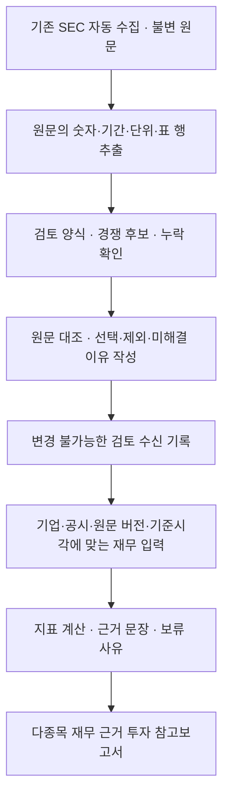

# 공시 원문 검토와 다종목 재무 보고서 연결

후속 [연간·전년 대비 비교](SEC_GROWTH.md)는 이 검토 방법을 변경하지 않는 별도 저장소·계산·보고서다. 현재 실적의 승인 기록과 같은 공시의 전년 비교 열을 연결하며, 기존 수신 시각·의미·기간 검사는 유지한다.

2026-11-08~09 구현·확인. 자동 추출 자료에서 사용할 항목을 원문과 대조하고, 검토 근거를 가진 재무 입력만 별도 보고서에 연결한다. 월 데이터 예산 $0, 개인 로컬 연구, 외부 LLM API·뉴스·가격 요청·모델 학습 0회를 유지한다. 이 검토는 회계감사나 예측 수익성 검증을 뜻하지 않는다.

## 동작하는 경로



| 파일 | 역할 |
|---|---|
| `sec_filing_evidence.py` | 저장 공시의 inline XBRL(원문 안의 기계 판독 회계 태그)에서 숫자·배율·부호·기업·기간·단위·표 행을 추출한다. 추출은 의미 검토 승인이 아니다. |
| `sec_fact_review.py` | 검토 양식과 선택·제외·미해결 판정, 최초 수신 시각을 보관한다. |
| `sec_financial_context.py` | CIK(SEC 기업 식별번호)와 보고서 기준시각에 맞는 검토를 읽는 공통 재무 입력 어댑터다. |
| `sec_financial_report.py` | 입력·계산을 재검증하고 수치·원문 링크·근거·반론·추적 조건·자료 부족을 한국어/JSON으로 출력한다. |

기존 `sec_report.py`의 BE 고정 입력과 가격·뉴스·관찰·과거 평가 코드는 변경하지 않는다. 새 보고서는 별도 `sec-financial-research-v1` 계약이다. 회사 재무 근거를 보고서에 연결했으며 목표가·주가 시나리오·매력도는 보류한다. 기존 종합 BE 보고서에 새 입력을 자동 주입하거나 산업별 가격 평가를 변경하지 않는다.

## 원문 대조와 보류

CIK, 공시 번호·형태, 시작일·결산일, 단위·배율·부호를 확인한다. 부문별 추가 차원, 숨겨진 숫자, 표 행이 없는 문장과 알 수 없는 숫자 형식은 기본 후보에서 제외한다. 표시 괄호와 XBRL 부호를 중복 적용하지 않는다. 유형자산 취득액은 XBRL의 양수 현금 지출액으로 보존한 뒤 현금흐름에서 차감한다.

각 검토에는 선택한 원문 숫자 ID, 귀속 범위, 행 제목, 의미 정의, 선택·제외 이유를 작성한다. 새 금액을 입력해 승인할 수 없으며 저장 원문에 존재하는 적합한 숫자를 선택해야 한다. 값·기간이 다른 경쟁 후보를 제외했다면 해당 후보도 명시한다. 원문 태그가 있어도 의미가 다르면 미해결로 기록한다.

SEC companyfacts의 정의와 원문 행을 대조해 `ProfitLoss`는 비지배지분 몫을 포함한 연결 전체 순손익, `NetIncomeLoss`는 지배기업 귀속 순손익으로 구분한다. 지배기업 귀속 순손익을 연결 전체 매출로 나눈 순이익률은 현재 보류한다.

| 상황 | 처리 |
|---|---|
| 원문 숫자와 범위가 확인됨 | 해당 항목을 검토된 재무 입력으로 전달 |
| 원문 값이 현재 의미 정의와 다름 | 미해결 이유를 보관하고 값은 null |
| 같은 검토자가 판단을 수정함 | 기록을 추가하고 해당 항목의 최근 기록 사용 |
| 여러 검토자의 값·기간·범위가 충돌함 | 특정 검토자를 임의 선택하지 않고 항목 보류 |
| 원문·공시 메타데이터·관련 수정 공시가 바뀜 | 현재 버전의 재검토 필요 |
| 예전 내용으로 되돌아옴 | 새 연속 버전으로 취급해 과거 승인을 자동 복원하지 않음 |
| 이름 등 관련 없는 메타데이터만 바뀜 | 같은 원문 검토 유지 |
| 수정 공시 존재 | 원본과 분리하고 파생 지표의 자동 합치기 보류 |

검토 종류는 `human_original_filing_review`와 `assistant_original_filing_review`를 구분한다. 보조 도구가 작성한 기록을 사람이 승인한 것으로 표시하지 않는다. 코드가 검사하는 것은 원문·숫자·기록 연결과 계산이며, 회계 의미의 진위를 독립적으로 증명하지는 않는다.

## 지표와 해석

분기 손익·주당순이익은 해당 분기, 연간 손익은 연간, 현금·자산·부채는 결산일 현재다. 분기 보고서의 현금흐름은 **회계연도 시작부터 누적**이며 회사에 따라 1월 외의 달부터 시작할 수 있다. 날짜를 함께 표시한다.

영업·순이익률은 같은 공시·기간·단위·연결 전체 범위의 검토값을 사용하고 매출은 양수여야 한다. 잉여현금흐름은 같은 기간 영업 현금흐름에서 음수가 아닌 유형자산 현금 취득 지출을 뺀다. 회사 자체 FCF 발표값과 같다고 주장하지 않는다. Decimal로 계산하고 이익률은 백분율 소수점 6자리로 기록한다. 비교 기간의 검토가 없는 성장률·TTM(최근 12개월 합계)은 계산하지 않는다.

문장은 확인한 손익·현금흐름의 양수·음수와 기간을 설명하는 고정 문안이다. 필수 수치가 없으면 해당 문장을 생성하지 않고, 반론·다음 조건·자료 부족을 함께 표시한다. 출력 검증은 원문·검토 기록을 다시 읽어 금액·계산·문장을 재생하고 임의 수치·출처·점수·문안 변경을 거절한다.

## 저장과 시점

`reports/private/sec_fact_reviews/real/receipts/<id>.json`에 원문·행·검토자·이유·방법 해시를 보관한다. 과거 검토 시각을 제출해도 이용 가능 시점은 최초 로컬 수신 시각이다. 기준시각과 같은 초에 수신한 기록은 순서를 추정하지 않고 보류한다. 뒤로 가는 시계도 거절한다.

검토는 원문 주소·해시와 그 내용이 연속 유지된 버전에 연결한다. 수정·되돌림이 과거 승인을 되살리지 않는다. 검토 로직·정책·계약이 바뀌면 새 방법으로 확인할 때까지 기존 기록을 보류한다. 보고서는 `reports/private/sec_financial_reports/real/<CIK>/<id>/report.json`과 `REPORT.ko.md`에 저장한다. 현재 재무나 오늘 검토를 예전 가격 평가에 소급하지 않는다.

## 실행

Stocker 폴더에서 사용한다. 공시·기업 스냅샷은 SEC 수집기로 먼저 보관한다. 아래 명령은 네트워크를 요청하지 않는다.

```powershell
.\.venv\Scripts\python.exe -B -m research.sec_fact_review --cik 1664703 --accession 0001628280-26-066931 --output reports/private/be_review_worksheet.json
```

양식은 `manifest`(검토 입력)와 `candidates`(원문 후보)를 분리한다. 원문 대조 후 manifest만 별도 JSON으로 저장한다. 검토자 ID·종류·시각, 항목별 선택·제외·이유를 채우고 `template_only`를 false로 바꾼다. 검토하지 않은 초안은 가져올 수 없다.

```powershell
.\.venv\Scripts\python.exe -B -m research.sec_fact_review --cik 1664703 --import-review reports/private/be_review_manifest.json
.\.venv\Scripts\python.exe -B -m research.sec_financial_report --ciks 1664703 789019 2115436
.\.venv\Scripts\python.exe -B -m research.sec_financial_report --ciks 1664703 --as-of 2026-11-08T13:00:00Z
.\.venv\Scripts\python.exe -B -m research.sec_financial_report --validate reports/private/sec_financial_reports/real/<CIK>/<id>/report.json
.\.venv\Scripts\python.exe -B -m research.sec_review_demo
```

나중에 검토한 값이 과거 `--as-of` 조회에서 나오지 않는 것이 정상이다. `--review-root`, `--source-store`, `--output`으로 별도 위치를 지정할 수 있다. 실제 자료는 프로젝트의 `reports/private` 아래를 사용한다. 데모는 `ILLUSTRATIVE — NOT LIVE MARKET DATA`를 표시하고 실제 자료의 자동 승인에는 사용할 수 없다.

## 검증

`tests/test_sec_fact_review.py`는 배율·부호·중첩 태그·부적합 형식, 기업/기간/단위/범위 배제, 초안·시간·중복·변조·경쟁 후보·검토자 충돌, 수정·되돌림·미래 정보 차단, 파생 지표와 보고서 재생을 검사한다. 가상 3개 기업·54개 수치 연결의 계약은 `examples/sec_review_golden.json`에 있다. 실제 검토 사례, 시험 데이터 성공, 주가 예측 성능은 각각 구분한다.

2026-11-08 완료 확인: 신규 64개를 포함한 전체 554개 테스트 통과. 저장 원문 4건(BE 연간·분기, MSFT·XOM 분기)을 보조 도구가 직접 대조한 검토로 기록하고 3개 실제 재무 보고서를 만들었다. BE 18/18개, MSFT 9/18개, XOM 7/9개의 항목이 연결됐다. 숫자는 항목 수이며 시장 성능 표본 수가 아니다. MSFT 연간 9개는 이번 검토 범위 밖이고, 순손익은 지배기업 귀속으로 표시해 순이익률을 보류한다. XOM 매출·영업손익은 의미 정의 또는 태그 매핑 미해결로 보류한다. 검토 전 기준시각의 BE 연결 항목 0개, 중복 가져오기 새 기록 0개와 세 보고서 재생 성공을 확인했다. 처리 중 새 소스/외부 LLM API 요청은 0회다. 원본 수집기와 기존 BE·패널 예약 작업의 해시는 모두 유효했다.
