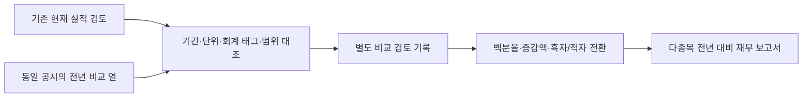

# 연간·전년 비교 검토와 성장률 보고서

후속 [QoQ·TTM 계층](SEC_QOQ_TTM.md)은 별도 원문 묶음·공시 간 검토·계산·보고서로 연결했다. 아래 전년 대비 계약의 보류 필드와 기존 검토 방법은 그대로 유지하며 새 계약에서만 기간 연결 결과를 제공한다.

2026-11-09 구현. 원문 검토를 마친 현재 값과 **같은 공시의 전년 같은 기간 값**을 대조해 성장률·증감액·손익 전환·이익률 차이를 보고한다. 개인 로컬 연구·월 $0이며 보고서 모듈의 소스 요청·외부 LLM API·학습·점수 변경은 0회다.

기존 SEC 수집기와 원문 검토 v1 코드·정책·스키마는 변경하지 않았다. 기존 검토 기록과 보고서도 그대로 재생한다. 미검토 연간은 기존 `sec_fact_review` 절차로 추가하고, 비교 기간은 새 `sec_period_review` 저장소에 기록한다.



## 비교 승인 조건

현재 실적의 원문 검토가 먼저 완료돼야 한다. 비교 검토는 현재 검토의 정확한 수신 기록·선택 원문 숫자와 원문 주소·해시·연속 버전에 연결한다. 같은 기업·공시·회계 태그·단위를 사용하고 귀속 범위를 유지한다. 지배기업 귀속과 연결 전체 순손익을 합치지 않는다.

전년 종료일과 시작일의 간격은 각각 358~373일, 기간 길이 차이는 최대 7일이다. 52/53주 회계연도 및 윤년 차이를 수용하는 후보 검사이며, 실제 기간·정의 비교 가능성은 원문 검토 이유로 확인해야 한다. 날짜 범위에 들어온다는 것만으로 의미가 같다고 자동 승인하지 않는다. 결산일 잔액은 다른 결산일 잔액과, 분기 손익은 분기 손익과, 회계연도 누적 현금흐름은 같은 누적 기간과 비교한다.

같은 태그도 표·정의가 맞지 않으면 보류한다. 부문별 추가 차원·숨겨진 값·다른 기업·표 행이 없는 값 등은 기존 원문 후보 규칙대로 제외한다. 분기 공시에 직전 연말/회계연도 말 잔액만 있으면 이를 전년 같은 날짜로 바꾸지 않는다. 다른 CIK의 전신 기업 수치나 다른 공시를 자동으로 합치지 않는다.

## 산식과 해석

| 항목 | 계산·표시 |
|---|---|
| 전년 대비 백분율 | `(현재−전년) ÷ 전년 × 100`, 전년 값이 양수일 때만 제공 |
| 증감액 | `현재−전년`, 원래 금액 또는 주당 단위 유지 |
| 이전 값이 적자·0 | 백분율은 null. 적자→흑자, 흑자→적자, 적자 규모 축소/확대와 증감액 표시 |
| 이익률 변화 | 양쪽 이익률을 각각 계산한 뒤 차이를 **%p(퍼센트포인트)**로 표시 |
| 잉여현금흐름 비교 | 각 기간 `영업 현금흐름−유형자산 현금 취득 지출`을 계산한 뒤 비교 |
| 자산·부채·현금 | 결산일 **잔액 변화율**이며 이익 성장이나 투자 매력도로 해석하지 않음 |

Decimal로 계산하며 백분율·퍼센트포인트는 소수점 6자리다. 작은 양수 기준값의 큰 변화율은 절대 증감액과 함께 본다. 희석 주당순손익에는 주식수 변화도 반영된다. 적자·0 기준을 절댓값으로 바꿔 양수 성장률을 만들지 않는다. 이익률 차이는 상대 성장률로 표시하지 않는다.

현재·전년 각각 매출과 이익의 기간·단위·연결 전체 범위가 맞아야 이익률을 계산한다. 순손익이 지배기업 귀속이면 연결 전체 순이익률 비교는 보류한다. 현금흐름·유형자산 취득 지출도 양쪽 기간이 각각 맞고 지출액이 음수가 아니어야 한다. 이 FCF 정의가 회사 발표 지표와 동일하다고 주장하지 않는다.

이 전년 대비(YoY) 계약 안의 전분기 대비(QoQ)·최근 12개월(TTM) 필드는 보류로 유지한다. 후속 계산은 별도의 [기간 연결 계약](SEC_QOQ_TTM.md)에서 제공하며, 기간 공백을 연간÷4 등으로 채우지 않는다.

## 변경·충돌·시점 보존

검토 초안은 사용할 수 없다. 비교할 전년 숫자의 원문 ID·행 제목·귀속 범위·비교 가능 이유·제외한 경쟁 후보를 기록한다. 검토 파일에 임의 금액을 넣어 승인할 수 없다. 기록은 append-only이고 첫 실제 수신 시각 이후에만 사용한다. 기준시각과 같은 초의 기록도 보류한다. 나중의 검토를 과거 보고서에 소급하지 않는다.

현재 값의 검토가 바뀌면 전년 비교도 새 검토가 필요하다. 원문 수정·되돌림·수정 공시, 비교 방법 변경, 검토자 충돌도 보류한다. 새 비교 방법이 바뀌어도 기존 현재 실적의 검토를 무효화하지 않으며 기존 원문 검토 v1 자체도 그대로다.

현재 공시의 전년 비교값에는 재분류·수정 등이 반영될 수 있다. 이를 당시 원본과 같다고 주장하지 않고, 진행 중인 과거 가격 평가·잠긴 최종 시험에 소급 투입하지 않는다. 검토자는 사람과 보조 도구를 구분하며 코드 검증이 회계 해석의 정답이나 미래 수익을 증명하지는 않는다.

## 모듈·저장·실행

`sec_period_review.py`는 별도 비교 검토, `sec_growth.py`는 계산, `sec_growth_report.py`는 현재 재무 보고서와의 조합·재생 검증·한국어 출력을 담당한다. 비교 검토는 `reports/private/sec_period_reviews/real/receipts/`, 보고서는 `reports/private/sec_growth_reports/real/<CIK>/<id>/`에 보관한다.

Stocker 폴더에서 현재 실적을 먼저 검토한 뒤 실행한다.

```powershell
.\.venv\Scripts\python.exe -B -m research.sec_period_review --cik 1664703 --accession 0001628280-26-066931 --output reports/private/be_yoy_worksheet.json
```

양식의 `current_anchors`는 승인된 현재 값, `candidates`는 전년 후보, `manifest`는 작성할 검토다. 원문 대조 후 manifest만 별도 JSON으로 저장한다. 검토자·종류·시각·비교 이유·선택/제외를 작성하고 template_only를 false로 바꾼다. 확인하지 못한 항목은 unresolved로 유지한다.

```powershell
.\.venv\Scripts\python.exe -B -m research.sec_period_review --cik 1664703 --import-review reports/private/be_yoy_manifest.json
.\.venv\Scripts\python.exe -B -m research.sec_growth_report --ciks 1664703 789019 2115436
.\.venv\Scripts\python.exe -B -m research.sec_growth_report --ciks 1664703 --as-of 2026-11-08T14:00:00Z
.\.venv\Scripts\python.exe -B -m research.sec_growth_report --validate reports/private/sec_growth_reports/real/<CIK>/<id>/report.json
.\.venv\Scripts\python.exe -B -m research.sec_growth_demo
```

출력 검증은 현재 보고서를 기존 방법으로 재생하고, 별도 비교 기록에서 전년 값·산식·출처·귀속 범위·퍼센트포인트를 재계산한다. 목표가·매력도는 계속 null이다. 실제·가상은 분리하며 가상 자동 선택 도우미는 실제 자료를 승인할 수 없다.

## 검증

`tests/test_sec_growth.py`는 양수·음수·0 기준, 큰 수 정밀도, 분기/누적·연간·잔액 구분, 52/53주 범위, 초안·원문/현재 검토 변경·되돌림·수정·충돌·변조·첫 수신 시각, 이익률 %p와 현금흐름, 기존 코드 보존·보고서 재생을 검사한다. 가상 3개 기업·54쌍 연결은 `examples/sec_growth_golden.json` 계약이다. 테스트 통과, 실제 원문 대조, 미래 예측 성능은 각각 구분한다.

2026-11-09 확인: 신규 50개를 포함한 전체 604개 테스트 통과. MSFT 연간 9개 항목의 원문 검토를 추가해 현재 재무 검토는 BE 18/18개, MSFT 18/18개, XOM 7/9개다. 동일 공시 5건의 실제 전년 비교는 BE 15/18쌍, MSFT 15/18쌍, XOM 4/9쌍으로 총 34쌍이다. 분기 잔액의 전년 동일일자 부재 9쌍과 XOM 현재 항목 미해결 2쌍을 보류했다. 현재 CIK에서 보관된 XOM 연간 공시는 없어 분기 범위이며 전신 CIK와 합치지 않았다.

새 보고서 3건의 원문·검토 재생, 비교 검토 전 시점의 BE 0쌍, 중복 가져오기 새 기록 0건과 기존 재무 보고서 3건의 재생을 확인했다. 새 소스·외부 LLM API 요청은 0회이며 세 예약 작업의 무결성도 유효했다. 항목·쌍의 수를 시장 예측 성능 표본 수로 해석하지 않는다.
