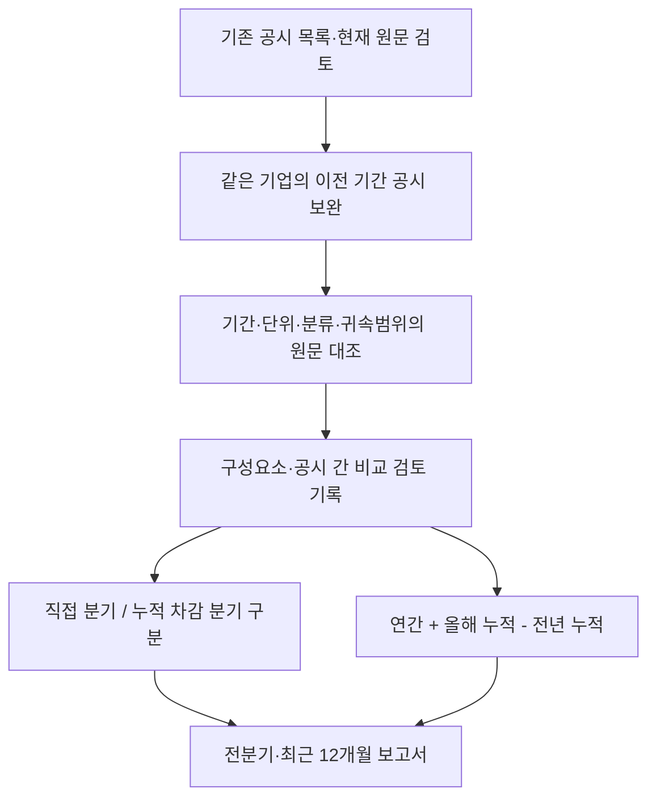

# 전분기 비교와 최근 12개월 재무 연결

2026-11-09 구현. 저장한 공시의 기간을 보완하고, 원문 대조한 구성요소로 전분기 대비(QoQ)와 최근 12개월 누적(TTM)을 계산한다. 기존 공시 수집기·원문 검토·전년 대비 보고서·가격 평가의 코드와 정책은 수정하지 않았다. 새 단계는 별도 정책·검토 저장소·보고서 계약을 사용한다.

## 목적과 지원 범위

매출, 영업손익, 순손익, 영업활동 현금흐름, 유형자산 현금 취득 지출의 5개 가산 가능한 항목을 대상으로 한다. 같은 CIK(SEC 기업 식별번호)·회계 태그·USD 단위·귀속 범위를 유지한다. 연결 전체와 지배기업 귀속 순손익을 섞지 않는다. 가중평균 주식수에 기초한 EPS를 연간에서 빼거나 더해 분기/TTM으로 만들지 않으며, 시점 잔액도 TTM 누적 대상에서 제외한다.

초기 프로파일은 가장 최근 재무 공시가 10-Q인 경우다. 현재 분기보다 앞선 연간 공시, 이전 분기 또는 연간 말, 필요한 이전 누적 분기 공시를 선택한다. 최신이 연간인 별도 프로파일, 전신·후신 CIK 연결, 숫자가 바뀐 수정 공시 자동 반영은 지원하지 않고 이유를 보류한다.



## 수집·저장

`sec_chain_sources.py`는 기존 공시 목록에서 필요한 원문만 선택하고 공유 SEC 전송기의 캐시·1초 이상 간격·일일 요청/다운로드·원문 용량 한도를 그대로 사용한다. 기업당 한 번에 최대 실제 요청 4회·120초다. 원문 4개와 수정본 등이 모두 만료돼 상한에 걸리면 다음 호출에서 캐시를 재사용해 이어간다. 가입·유료 데이터·가격 API를 추가하지 않는다. 수정본도 별도 원문으로 보관한다.

묶음은 `reports/private/sec_chain_sources/real/<CIK>/packets/`와 `receipts/`에 불변 원본 참조·해시·실제 저장 시각으로 남긴다. 같은 내용 재확인은 새 버전을 만들지 않는다. 내용 변경·되돌림·수정 목록 변화는 새 연속 버전이다. 실패·누락은 0이나 정상 자료로 바꾸지 않고 기존 버전은 보존한다.

`sec_chain_review.py`는 각 항목의 현재 분기, 올해 누적, 전년 누적, 연간, 이전 분기, 이전 누적, 더 이전 누적 역할을 구분해 원문 숫자 ID·행 제목·선택/제외·공시 간 비교 이유를 기록한다. 현재와 연간의 기존 검토 기록도 묶음에 연결한다. 실제 값 입력은 허용하지 않고 적합한 원문 숫자만 선택한다. 검토자는 사람과 보조 도구를 구분한다.

## 계산식과 날짜 검사

| 대상 | 계산 |
|---|---|
| 분기 손익 | 원문의 직접 3개월 값 사용 |
| 중간 분기의 현금흐름 | 같은 회계연도의 현재 누적 − 이전 누적 |
| 연말 4분기 손익·현금흐름 | 연간 − 같은 회계연도 9개월 누적 |
| 전분기 증감 | 인접한 현재 분기와 이전 분기 비교. 이전 값 ≤ 0이면 백분율은 보류하고 증감액 유지 |
| 최근 12개월 | 직전 연간 + 올해 누적 − 전년 같은 누적 |
| 잉여현금흐름 | 같은 기간의 영업 현금흐름 − 음수가 아닌 유형자산 현금 취득 지출 |

분기 길이는 60~120일, 비교하는 두 분기 길이 차이는 최대 7일이다. 이전 종료일 다음 날이 현재 시작일이어야 한다. 누적 차감은 시작일이 같고 한 기간이 다른 기간 안에 포함돼야 하며 남는 기간이 한 분기여야 한다. 연간과 TTM은 330~400일이다. 올해 누적은 직전 연간 종료일 다음 날 시작하고, 전년 누적 시작일은 연간 시작일과 같아야 한다. 누락을 0, 연간÷4 또는 단순 평균으로 채우지 않는다.

새 공시와 이전 공시에 중첩된 손익을 정확히 대조한다. 예를 들어 `현재 9개월−현재 분기=이전 6개월`, `이전 6개월−이전 분기=3개월`이 제공된 구성요소와 다르면 전분기 비교를 보류한다. 반올림·재분류·수정 등 원인을 자동 추정하지 않는다. 현금 취득 지출의 차감 결과가 음수면 추가 검토 전 보류한다. Decimal로 계산하며 산식·입력 값·원문·기간을 보관한다.

## 수정 공시·검토 충돌·시점

수정본이 있으면 기본적으로 검토 대기다. 별도로 수정 이유를 읽고 **선택한 구성요소가 같다는 범위의 검토**를 작성해야 한다. 코드도 수정본의 같은 태그·기간·통화·단위·기업 수치를 다시 대조해 선택값과 정확히 일치하는지 확인한다. 누락·변경·경쟁 값이 있으면 단순한 승인 문구로 통과시킬 수 없다. 다른 위험 서술까지 변화가 없다고 판단하지 않는다.

원문 묶음, 현재/연간 검토, 비교 방법이 바뀌면 기존 기간 연결 기록을 재사용하지 않는다. 명시적 미해결과 검토자 간 구성요소 충돌도 보류한다. 검토는 `reports/private/sec_chain_reviews/real/receipts/`에 append-only로 저장한다. 제출자가 과거 검토 시각을 적어도 실제 수신 전에는 이용할 수 없고, 기준시각과 같은 초도 보류한다. 원문 되돌림은 새 버전으로 취급한다.

현재 확보한 공시·수정·재분류를 과거 가격 평가의 당시 입력으로 소급하지 않는다. 검토 기록은 작성자의 원문 대조 주장이며 코드가 회계감사·투자 수익·예측 정확도를 증명하지 않는다.

## 실행

Stocker 폴더에서 사용한다. 첫 명령만 SEC 네트워크 수집을 수행하며 설정된 SEC_USER_AGENT를 요청 헤더에만 쓴다. 다음 검토·보고서 명령은 저장 자료만 읽는다.

```powershell
.\.venv\Scripts\python.exe -B -m research.sec_chain_sources --ciks 1664703 789019 2115436
.\.venv\Scripts\python.exe -B -m research.sec_chain_review --cik 1664703 --output reports/private/be_chain_worksheet.json
```

양식의 manifest만 별도 파일로 저장하고 원문 대조 후 검토자·시각·현재 승인 연결·역할별 숫자 ID·행 제목·제외 후보·공시 간 비교 이유를 채운다. 수정본이 있으면 amendment_assessments도 작성한다. 검토하지 않은 초안은 가져올 수 없다.

```powershell
.\.venv\Scripts\python.exe -B -m research.sec_chain_review --cik 1664703 --import-review reports/private/be_chain_manifest.json
.\.venv\Scripts\python.exe -B -m research.sec_chain_report --ciks 1664703 789019 2115436
.\.venv\Scripts\python.exe -B -m research.sec_chain_report --validate reports/private/sec_chain_reports/real/<CIK>/<id>/report.json
.\.venv\Scripts\python.exe -B -m research.sec_chain_demo
```

보고서는 `reports/private/sec_chain_reports/real/<CIK>/<id>/report.json`과 `REPORT.ko.md`다. JSON은 기존 현재 실적·전년 대비 보고서도 포함한다. 새 계약은 `sec-reviewed-qoq-ttm-v1`이며 예전 보고서의 보류 필드를 덮어쓰지 않는다. 새 계산은 직접 분기값과 차감 분기값을 구분한다. 목표가·매력도·TTM 증감률·가격 및 뉴스 모델은 추가하지 않는다.

## 검증

`tests/test_sec_chain.py`와 `examples/sec_chain_golden.json`은 달력연도/다른 회계연도, 현금흐름 차감과 연말 4분기, 기간 공백·비가산 항목·귀속 범위, 중첩 불일치, 수정본의 명시적 대조·수치 변경 거절, 수신 시각·변조·되돌림·현재 검토 변경·충돌, 요청 상한 재개·429 대기를 검사한다. 가상 데모는 두 기업 계산 성공과 자료 부족 기업의 보류를 포함하며 실제 자료의 자동 승인에는 사용할 수 없다.

2026-11-09 실제 적용에서 BE/MSFT는 전분기·최근 12개월 각각 5/5개를 계산했고 XOM은 동일 기업 식별번호의 연간 자료 공백으로 보류했다. 별도 검토 2건은 원문 구성요소 역할 54개를 선택했으며, 이는 독립된 시장 표본 수가 아니다. BE의 이전 분기 정정본은 고객 주석의 3개월·6개월 표현 정정이므로 선택 재무 수치의 일치만 대조하고 위험 서술은 별도로 남겼다. 신규 보고서 3건·기존 보고서 6건 재생, 예약 3건의 무결성과 전체 659개 테스트(신규 55개)를 확인했다. 추가 SEC HTTP 요청 4회, 보고서 생성·외부 LLM API 0회. [로컬 결과 설명](../reports/private/sec_chain_case/20261109/SUMMARY.ko.md), [검토·보고서 감사 기록](../reports/private/sec_chain_case/20261109/RESULTS.json).
