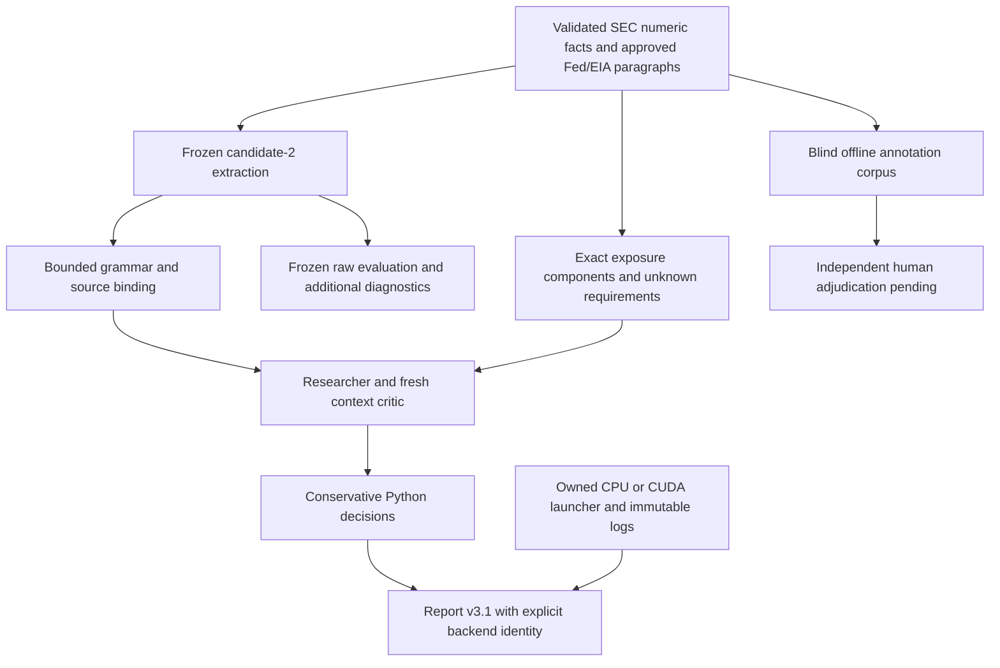

# ResearchEngine v3 maturation runbook

Reference: `64bd4ccfcc926152db25a3c67478c1ac279ff562` (engine v3).
Current private evidence: `reports/private/maturation_case/20261111/`.
Implementation, software testing, actual inference, quality pass and independent
validation are separate statuses. All paths remain SHADOW, with null released
scores, targets and plans. No promotion follows from ranking failed experiments.



The original `research_v3_report` identifies CUDA subclasses as CPU. Preserve that
file because it is included in candidate-2 method registrations. New consumers
must import `research_v3_report_v2.build/write/validate`. Report contract v3.1
adds `local-backend-identity-v1`, with CPU, CUDA, MOCK and NOT_RUN identities.
An owned launcher, pinned artifact bytes, loopback authentication, original log
and CUDA layer/KV proof are required before an actual-execution claim. Constructed
objects, unknown subclasses and mocks cannot establish actual execution.
Frozen evaluation receipts receive an additional sidecar via
`backend_identity.evaluation_identity`; original receipts remain unchanged.

CPU requires available host RAM >=4,000,000,000 bytes. The separately registered
CUDA policy requires host RAM >=2,000,000,000 and dedicated free VRAM
>=5,000,000,000 bytes, independently. VRAM is not general system RAM. Both use
the same pinned Qwen3-4B GGUF and shared runtime lock. CUDA must show all reported
layers and a positive CUDA KV buffer; CPU-mapped embeddings and host runtime
buffers still consume RAM. Device usage includes other applications. Never
lower a floor, remove another process's lock, terminate another worker, silently
fall back, download a substitute model or install a driver.

From the repository root, run the existing immutable replication after checking
`gpu_eval.check(registration, inputs, gold)` and artifact preflight:

```powershell
.\.venv\Scripts\python.exe reports/private/maturation_case/20261111/audit_and_run.py run
.\.venv\Scripts\python.exe -m pytest extensions/tests/test_maturation.py -q
.\.venv\Scripts\python.exe -m pytest tests context_adapters/tests extensions/tests -q
```

The replication creates a new UUID directory and never replaces results. The
initial audit command and registration preparation are one-time write-once
operations, not commands to repeat over existing records. Do not regenerate
registrations after a method mismatch. Replays use `gpu_eval.validate` plus saved
raw responses; report replays use the appropriate versioned validator. Inference
requires local loopback/CUDA access under the execution environment's permissions.
No external inference or market API calls are part of this workflow.

Raw quality gates remain semantic/researcher/critic >=0.85, contract >=0.90,
false approvals zero and unnecessary abstention <=0.25 for every registered split.
The critic metric is end-to-end agreement after upstream model extraction; it
does not isolate critic ability. Deterministic rejection cannot rescue raw errors.
Missing cases remain in fixed denominators. NOT_RUN and partial resource failure
must stay explicit. Unsupported difficulty categories are NOT_MEASURED.

Candidate-3 adds ontology definitions, literal-null instructions and all eligible
numeric facts to fresh model context. Python semantics and decisions stay frozen.
Its new authored holdout and method/runtime hashes are registered before its
one-shot run. There is no independent gold or stock-return validation.

The exposure review adapter reparses existing authorized SEC numeric rows into
an offline review queue with CIK, source hash, locator, units, period, dimensions
and availability. Tag matches remain PENDING; balances cannot certify repricing,
energy contracts or net unhedged sensitivity. The queue does not feed AI_INPUT or
the frozen ledger. Missing reviewed contractual evidence leaves requirements
UNKNOWN and verified routes at zero. Normal issuer reports do not require a user
to annotate articles; offline human work supplies evaluation gold and exceptional
component review, not routine report composition.

Independent validation requires two outcome/model-blinded independent human
annotations, exact source/exposure citations and a third adjudicator for conflicts.
Do not use the tested model to generate or approve gold. Keep source-event and
issuer-event counts separate. The registered corpus contains pending labels only;
`INDEPENDENT_EVALUATION_NOT_RUN` remains mandatory. Publication dates without time
precision cannot establish reaction timing. Preserve first local availability;
never backdate it or insert current issuer context into historical forecasts.
Future price studies additionally require rights before data reads, frozen
predictions, exchange-session and adjustment definitions, selection/overlap and
confound reviews. Semantic accuracy never establishes price prediction.

Root documentation migration is deferred: historical v3 report baselines bind
those exact bytes without a documentation exception. Altering them would break
the unchanged historical validator. Current guidance lives in this declared
extension scope; do not silently relax that validator or rewrite old baselines.
A later migration needs an explicit versioned historical replay strategy.

Security: ignored directories are not private if already tracked. The initial
audit identified three tracked legacy evaluation artifacts, including an authored
answer key. Record their exposure without deleting evidence or rewriting history.
Future remediation should untrack only after review, retain private immutable
copies, inspect historical disclosure and rotate any confirmed credentials.
Do not commit new private artifacts or keys, and do not automatically push.

Promotion requires every frozen raw/per-split gate, useful coverage on actual
approved language, exact issuer exposure, independently adjudicated real events,
PIT/source rights review and separate price-performance evidence where claimed.
Five jobs, original price behavior, factors, coefficients and locked finals remain
outside this experiment.

The 2026-11-11 audit executed all candidate-2 A-E configurations: 505 request
attempts and 501 schema-valid completions, with every registered quality gate
decision remaining `quality_gate_failed`. Candidate-3's separately registered
16 authored cases / 17 propositions produced 49 attempts and 43 schema-valid
completions: exact semantics 6/17, researcher 4/17 and end-to-end critic 8/17;
its gate also failed. These different datasets do not establish a controlled
improvement comparison. All raw responses, including truncations, are preserved.

The first actual report attempt exposed mutable telemetry changing the sealed
identity during cleanup. That failed attempt and all 24 raw responses are retained
in `REPORT_PROVENANCE_FAILURE.json`; candidate-3 was not rerun. Identities now
deep-copy telemetry and preserve a content-addressed runtime log snapshot. The
subsequent real CUDA BE report passed save, shutdown and replay checks, including
an HTTP 401 rejection for an invalid local credential.

Final software regression: 1,346 passed, one Windows symlink-privilege skip;
focused checks 123 passed and affected-v2 checks 89 passed. The initial 1,345-pass
receipt remains unchanged. The
actual approved corpus has four shared documents, 22 paragraphs and 61 bounded
spans, with zero spans eligible under the current grammar. This is a coverage
diagnostic, not measured real-world precision/recall. The pending annotation
corpus has 66 issuer-paragraph rows and 12 issuer-document pairs; it has zero
independent labels. Three pilots retain 14 UNKNOWN exposure requirements each
and zero verified conditional routes. Detailed receipts and remaining blockers
are in `reports/private/maturation_case/20261111/DEVELOPMENT_REPORT.ko.md`.
