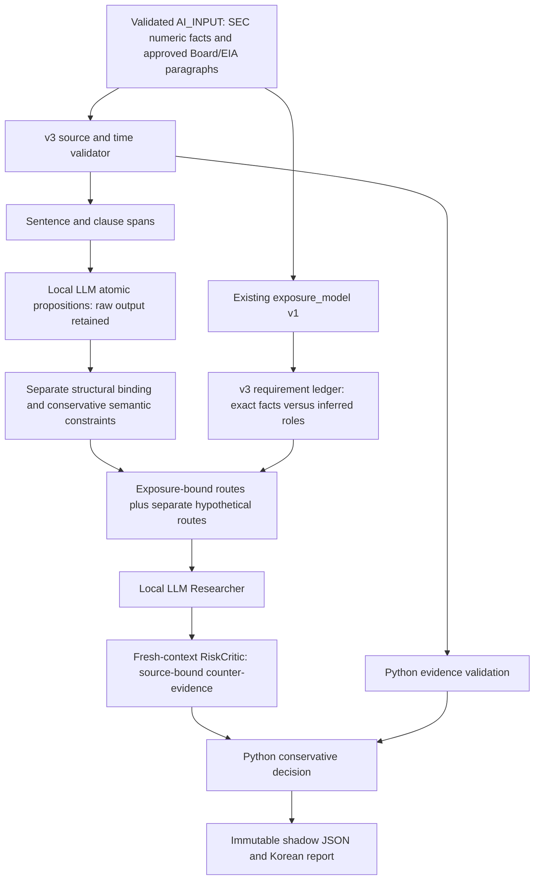

# Evidence-Grounded ResearchEngine v3 (candidate)

This separately versioned, offline extension preserves every v1/v2 method and receipt. The original `extensions.impact_report` CLI remains the legacy path. `python -m extensions.research_v3_report --ticker BE --baseline <v3 baseline> --mode v3_shadow` is the new path. No article-by-article user interpretation is required. Without a local backend it saves an explicit NOT_RUN partial report. `--infer` requests the existing authenticated CPU runtime subject to its unchanged memory/rights limits. `v3_candidate` only registers a request for later approval; it never adopts AI or releases a score.

The final development revision is `research-engine-v3-candidate-2`. A post-registration software audit found three nonassertive/hypothetical spans accepted by candidate 1; its source snapshot, registration, failed audit, NOT_RUN trials and reports are preserved under `reports/private/research_v3_case/20261110`. Candidate 2 adds an explicit conservative barrier for questions and examples and has a separate preregistration. The original gold and quality thresholds are unchanged. This change is not evidence of actual Qwen or market performance improvement. The completion report in that directory links the next `final.baseline.json` and all receipts.

## Boundaries fixed before implementation

`semantic_research` v1 assigns one label per paragraph, computes claim kind partly from the entire paragraph and guards categories partly by word presence. `issuer_impact` v1 seeds energy purchase and sale routes from positive generic revenue. `impact_report` uses `impact_critic` v1; `critic_v2` is a separate experimental evaluation and is not substituted into that report. `exposure_model` is a separate numeric/role report, not an input to the legacy route generator. Existing source/rights, hashes, cutoff, numeric checks and failed quality gates are useful and remain unchanged.

v3 consumes only `analysis_contract.export_ai` output. Prices, price derivatives, LOCAL_INPUT, vendor news metadata and filing prose never enter prompts. An immutable source copy and original bundle binding support replay. Dates without time precision remain dates. First local availability is never an event/publication timestamp. Old source windows and missing current evidence remain explicit.

## Contracts and ownership

- `research_v3_contract`: versioned policy/schema, input boundary, method hashes.
- `semantic_v3`: exact sentence/clause spans; model proposes variables, direction, negation, modality, condition and time locally. Python binds quotes and checks a deliberately limited compositional grammar. Outside that grammar the result is AMBIGUOUS, not verified by word overlap. This is a bounded consistency check, not general linguistic truth certification.
- `exposure_v3`: consumes `exposure_model.derive`; preserves exact units, periods and scopes, including XOM sales. Numerical balances never prove contractual sensitivity. Route requirements are separate propositions. Missing/role-inferred requirements cannot yield an applicable VERIFIED route. Hypothetical routes remain available for research.
- `evidence_v3`: validates copied fact assertions, CIK, source links, periods, unit, scope, value, duplicates/conflicts and first availability separately from semantic decisions.
- `research_v3`: Researcher selects mechanisms/assumptions; RiskCritic sees evidence and the claim in a fresh role, without rule answers or gold. Counter-evidence must bind an exact eligible source quote. General cautions and absent evidence are separate. Both stages share model weights and are not statistically independent.
- `research_v3_report`: saves source snapshot, raw outputs, usage/errors, deterministic decisions and rendering with hashes. Shadow never enters the 23-factor ledger or price engine. Replay performs no inference.
- `research_v3_eval`: preregisters separate input/gold, code, configuration and thresholds before inference. Reports raw mistakes, rule blocks, unnecessary abstention, coverage and each split separately. A never-approve system cannot pass useful-coverage gates. Synthetic authored tests and independent real events are separate denominators. Model quality NOT_RUN is never PASS.

Final decisions: SUPPORTED_CONDITIONAL, UNSUPPORTED, CONTRADICTED, AMBIGUOUS, INSUFFICIENT_EVIDENCE, INFERENCE_FAILED. A conditional mechanism is not a verified net business effect or stock reaction. Every route has unknown net effect, unknown stock horizon and null magnitudes/probabilities. Recommendation, target and trade plan remain null in all modes.

Five configurations are preregistered: A separated tasks at temperature 0.7; B low-temperature semantics; C semantics without numeric audits; D bounded explicit semantic steps (no private chain-of-thought output); E explicit abstention. The same pinned Qwen3-4B, revision, seed 1729, no thinking, CPU threads and memory floor are retained; only the v3 configuration changes. No automatic model download, external AI, paid service, fitting, new schedules or locked-final reads.

The software tests use ILLUSTRATIVE — NOT LIVE MARKET DATA fixtures. Actual BE/MSFT/XOM reports use existing replayed snapshots and disclose all missing business-exposure evidence. No actual contract is fabricated to make a path pass. Newly authored validation gold is hidden from the inference model, not independent of its developer. Independently adjudicated actual-event evaluation remains NOT_RUN until such labels exist.
