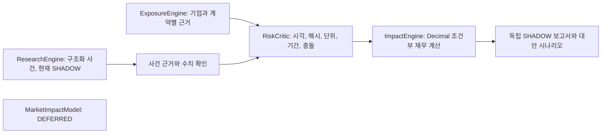

# ImpactEngine v1 — 조건부 재무 영향 계산

이 모듈은 `IMPLEMENTED` 상태의 별도 SHADOW 계산 계층이다. 주가 반응·목표가·투자 점수·주문을 계산하거나 기존 23요인 엔진에 연결하지 않는다. LLM, 수집 API, 모델 다운로드, 학습 및 예약 작업을 추가하지 않는다. 원래 v3/v3.1/v4 계약·방법·실패 점수·원시 결과·검증기는 그대로 둔다.

## 책임 분리



현재 ResearchEngine의 `SUPPORTED`는 잠정 모델 일관성이다. 이를 검증된 사건 크기나 계약 노출로 승격하는 자동 어댑터는 없다. 실제 기업 CLI는 저장된 승인 재무 맥락을 읽어 누락을 검사하고, 계약이 없으면 자동으로 null 보고서를 만든다. 일반 사용자에게 기사 해석 파일을 작성하도록 요구하지 않는다.

## 파일과 입력 계약

- `models.py`: EconomicEvent, IssuerExposure, ScenarioAssumptions, CalculationPolicy, PointInTimeContext 및 상태 정의.
- `contract.py`: `financial-impact-input-v1` / `financial-impact-output-v1`의 닫힌 JSON schema. 알 수 없는 필드·숫자 float·확률은 거절한다.
- `evidence.py`: 원문 UTF-8 해시, 정확한 code-point 위치, 원문 이용 권한, 공개/최초 가용 시각, 사실·검토 기록의 결합.
- `validator.py`: 동일 CIK/ticker/계약 instrument, 통화·회계 범위·보고 기간, 금리 지표 식별자·연동 범위, 헤지, 중복/겹침 검사.
- `calculations.py`: `Decimal` 50자리, `ROUND_HALF_EVEN`, 명시적 bp 및 원금 배율, 실제 날짜 계산.
- `scenarios.py`: 입력을 복사한 Base/Bull/Bear. 원래 사건·근거와 기존 결과를 변경하지 않는다.
- `report.py`: 재계산·변조 탐지·불변 파일 묶음과 한국어 보고서. 구 보고서에는 읽기 전용 참조로 연결한다.
- `adapters.py`: 동결 BE/MSFT/XOM 입력과 노출 원장을 읽는 계약 부족 probe. 기존 사실의 범위를 그대로 보존한다.
- `energy.py`: 구매 비용/판매 매출 인터페이스와 단위 검사. 금액 계산은 `DEFERRED`.
- `examples.py`: **ILLUSTRATIVE NOT LIVE DATA** 입력만 제공한다.

모든 최상위 입력 필드는 필수다. 누락 값은 명시적인 null이며 0·USD·금리 연동 1·헤지 없음으로 채우지 않는다. `context_facts`는 기존 재무 맥락이며 계산 근거 `facts`와 분리한다. `origin`은 동결 입력/노출 원장의 경로와 해시를 고정한다. 해당 원문·맥락이 바뀌면 보류한다.

원문은 원래 UTF-8 바이트를 손실 없이 `text`에 보관하고 그 바이트의 `original_sha256`을 제공한다. PDF/HTML을 임의 정규화한 텍스트 해시를 원본 파일 해시로 부르지 않는다. 이 v1은 그런 변환/문서 파서를 제공하지 않는다. 위치는 Python/Unicode code point의 `[start_offset,end_offset)`이며 범위를 벗어난 인용을 거절한다.

각 사실은 source_id, fact_id, 원문 해시, 정확한 인용, 공개·가용 시각을 연결한다. 기업 계약 사실에는 CIK/ticker/instrument_id/통화/회계 범위/보고 기간과 유효 구간을 갖춘다. 세계 금리 사건에는 별도 지표 식별자와 금리 통화가 필요하다. 금리 연동 사실은 같은 지표·통화에 대한 계약 관계와 선형 적용 가능 bp 범위를 명시해야 한다.

REAL 모드에서는 `VERIFIED` 문자열만으로 계산하지 않는다. 원문/사실 해시와 결합한 외부 검토 기록, 검토·가용 시각, 소유자가 별도로 신뢰한 review hash 목록을 요구한다. 이 체크섬과 allowlist는 **검토자 신원이나 경제적 진실의 암호학적 인증이 아니다**. 도구는 사람 판단·정답·검토 기록을 자동 생성하지 않는다. 실제 독립성 확인은 별도 업무다. `EVIDENCE_VERIFIED`는 공급된 신뢰 계약의 결정론적 검사를 뜻하며 실제 손익·독립 시장 정답의 입증이 아니다. 이번 실제 세 기업 자료에는 해당 계약 근거가 없다.

## 금리 산식과 지원 범위

```text
RepricingPrincipal = documented contract principal base × verified applicable fraction
UnhedgedPrincipal = RepricingPrincipal × (1 − verified hedged fraction)
ApplicableRateDelta = event delta × documented contract transmission factor
ExpenseDelta = UnhedgedPrincipal × ApplicableRateDelta × actual days / year denominator
```

`repricing_principal` 사실은 특정 이자부 계약의 확인된 재설정 가능 원금 기반이다. `repricing_fraction`은 그 원금에서 해당 계산에 적용할 부분이며, 둘을 서로 다른 계약이나 범위에서 가져오면 안 된다. 이미 축소된 원금에 비율을 중복 적용하지 않도록 검토자가 범위를 확인해야 한다. 총부채는 이 사실의 대체값이 아니다.

시작은 계산 시작일·사건 효력일·계약 reset일 중 가장 늦은 날짜, 끝은 계산 종료일이다. 종료일은 제외한다. reset이 종료 뒤라면 유효 일수 0에 대한 **검증된 0**이며 누락으로 인한 null과 다르다. 양수는 세전 이자비용 증가, 음수는 감소다. 순손익·현금흐름·주가를 같다고 가정하지 않는다.

- `25 bp = 0.0025`, `0.25 percentage_point = 0.0025`를 명시적으로 변환한다.
- 금액 단위는 CURRENCY / THOUSAND_CURRENCY / MILLION_CURRENCY만 지원한다. 통화 교환은 하지 않는다.
- `ACT/365F-v1`은 실제 날짜 수 / 고정 365, `ACT/360-v1`은 실제 날짜 수 / 고정 360이다. 윤년에도 365F의 분모는 바뀌지 않는다. Actual/Actual, 30/360, 영업일 이동, 복리·SOFR 일별 fixing/lag는 미지원이다.
- 계약으로 확인한 단일 reset 이후 일정한 원금·선형 연동·기간 전체 고정 상쇄 헤지만 지원한다. 상환표·cap/floor 경계·basis risk·복합/옵션 헤지·이자 자본화·세금·수수료는 보류하거나 후속 범위다.
- 알려진 계약 유효 구간이 계산 전체를 포함해야 한다. ‘90일 이내’ 같은 freshness는 입력 정책의 명시적 값이며 시장 관행의 자동 추정이 아니다.

공식 문서에서도 상품마다 day-count convention이 다르므로 통화만으로 선택하지 않는다. 참고: [Bank of England convention 표](https://www.bankofengland.co.uk/markets/money-markets-committee-and-uk-money-markets-code/the-uk-money-markets-code), [NY Fed/ARRC SOFR FRN 조건](https://www.newyorkfed.org/medialibrary/Microsites/arrc/files/2019/ARRC_SOFR_FRN_Matrix_Appendix.pdf). 문서 확인은 정의 검토용이며 실제 기업 계약을 취득하거나 승인한 것이 아니다.

## 상태와 시나리오

`ARITHMETIC_VERIFIED_CONDITIONAL`은 주어진 근거·가정으로 산식을 재현했다는 뜻이다. 자료 부족·충돌·단위 부적합·기간 오류·stale·미지원 사건·계산 실패는 각각 별도 상태이며 amount는 null이다. `SCENARIO_ONLY`는 가상 입력 또는 명시적 금리 대안이다. 실제 시장 의미 정확도는 계속 NOT_MEASURED다.

표준 대안은 Base 0bp, Bull -25bp, Bear +25bp다. Bull/Bear는 이자비용 관점이며 주가 방향이 아니다. 확률은 항상 null이다. 세 결과는 서로 대안이므로 합산하지 않는다. 금리 원본 사건의 증거가 없으면 대안 값을 넣어도 실제 기업 계산을 허용하지 않는다.

중복 검사는 입력 `prior_calculations`의 canonical_event_id, 동일 계약, 정규화한 금리 대안, 겹치는 계산 기간을 사용한다. 출력 `calculation.ledger_record`를 후속 입력에 전달하면 event_id나 사실 ID를 바꾸어도 같은 계산을 중복 승인하지 않는다. 전역 원장을 자동 조회하지 않으므로 호출자가 이전 기록을 제공해야 한다. 원문의 사건 동일성 자체도 자동 추론하지 않으므로 canonical ID의 외부 검토가 필요하다. v1에는 포트폴리오/시나리오 결과 합산 기능이 없다.

## 실행과 재생

Stocker 폴더에서 실행한다. 출력은 새 UUID의 private 폴더에만 저장하고 stdout에는 경로·상태만 쓴다.

```powershell
.\.venv\Scripts\python.exe -m extensions.financial_impact_v1 --demo
.\.venv\Scripts\python.exe -m extensions.financial_impact_v1 --ticker BE
.\.venv\Scripts\python.exe -m extensions.financial_impact_v1 --ticker MSFT
.\.venv\Scripts\python.exe -m extensions.financial_impact_v1 --ticker XOM
.\.venv\Scripts\python.exe -m extensions.financial_impact_v1 --input reports/private/my-impact-input.json
.\.venv\Scripts\python.exe -m extensions.financial_impact_v1 --validate reports/private/financial_impact_v1/<UUID>
.\.venv\Scripts\python.exe -m pytest extensions/financial_impact_v1/tests -q
```

입력 형식은 `examples.interest_example()`을 JSON으로 내보내 확인할 수 있다. 이 가상 입력을 실제 기업의 VERIFIED 기록으로 바꾸어서는 안 된다. CLI의 `--input`은 로컬 파일만 읽고 계약을 자동 취득하지 않는다.

저장물은 IMPACT.json, REPORT.ko.md, FILES.json이다. 입력·방법 해시·산식·일수·Decimal 결과·가정·반대 효과·누락·원문 위치·시나리오를 보존한다. `--legacy-report <folder>`는 원래 v3/v3.1 validator로 같은 기업과 cutoff를 확인해 참조한다. 원래 보고서는 편집하지 않는다. 옛 standalone inventory wrapper와 신규 개발 inventory는 분리하고 명시한 child baseline을 사용한다.

`stock_return_prediction`, `target_price`, `attractiveness_score`, `buy_price`, `sell_price`, `recommended_allocation`은 모두 null이다. MarketImpactModel, ValuationEngine, 에너지 금액, 실제 기업 계약 검증, 독립 시장 정확도, 투자 채택은 완료로 표시하지 않는다. 자동 commit/push는 하지 않는다.
