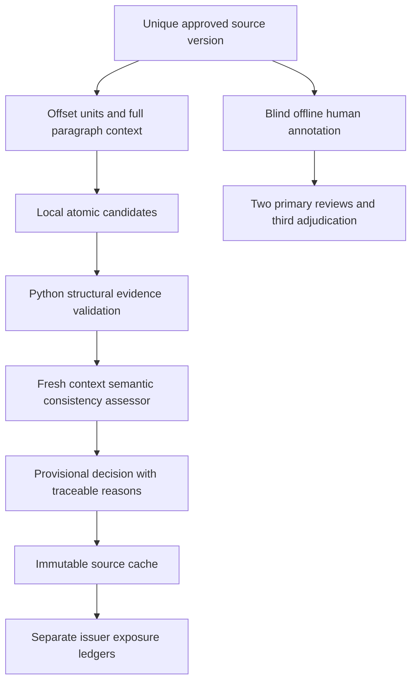

# ResearchEngine v4 candidate-1

This is a separate SHADOW candidate. It never changes frozen v3 rules or scores.
Source sentences and punctuation clauses preserve exact code-point offsets and
full paragraph context. The local model proposes at most two atomic propositions
per unit using exact subject/predicate/condition/time witnesses. Python validates
source identity, offsets, hashes, schemas, duplicates and evidence membership.
A fresh context of the same pinned Qwen model assesses semantic consistency.
It is not statistically independent and cannot certify semantic truth. SUPPORTED
means provisional source-bound model consistency; real precision and recall stay
NOT_MEASURED until independent labels exist. Unknown, negated expectations,
double negation and ambiguous anchors cannot silently become observed directions.



The cache key binds source bytes, exact time eligibility, method hashes and model
settings. Shared documents are extracted once across issuers. Batches reserve
three calls per unit, at most eight units / 24 calls per owned GPU server. Global
registered caps are source 160, authored 96, critic diagnostic 12, total 268.
Completed units are reused; failed attempts remain immutable and are not retried
by default. Explicit retries reuse completed extraction/assessment stages.
Partial, failed, omitted, safety-isolated and completed units remain distinct.
Existing authenticated loopback, GPU UUID/layer/KV proof, CPU/GPU RAM floors and
shared inference lock are reused without changing them or stopping other jobs.

v4 thresholds are separately registered before inference: supported precision
>=.90, supported recall >=.80, each field >=.85, contract >=.90, zero false
approvals, unnecessary abstention <=.25. Empty approvals cannot pass. These apply
only to the new authored experiment and never regrade candidate-2/3 failures.
Raw extraction, quote/anchor binding, field accuracy, final decisions and actual
independent validation are different measures. Different datasets are not a
controlled improvement comparison. Real source data has no gold and no accuracy.

Blind labeling is offline, without a server or external resources. Start with:

```powershell
python -m extensions.research_v4.labels assign --corpus CORPUS.json --reviewer reviewer-a --out reviewer-a
python -m extensions.research_v4.labels import --assignment reviewer-a.json --review reviewer-a-results.json --out review-a.sealed.json
python -m extensions.research_v4.labels compare --a review-a.sealed.json --b review-b.sealed.json --out disagreements.json
python -m extensions.research_v4.labels adjudicate --corpus CORPUS.json --a review-a.sealed.json --b review-b.sealed.json --reviewer reviewer-c --out adjudicator
python -m extensions.research_v4.labels seal --corpus CORPUS.json --a review-a.sealed.json --b review-b.sealed.json --adjudication adjudication.sealed.json --out GOLD.json
```

Open each generated HTML locally, select exact quotes, add multiple propositions,
assign negation/condition/time and reasons, affirm human blinding and download
JSON. Import each independent file separately. Initial reviewers cannot see other
answers or model outputs in their assignments, including the HTML source. Only
the adjudicator sees conflicting human answers. Sealing requires complete primary
reviews and distinct third-reviewer resolution of all disagreements. Reviewer
identity is declared offline and requires audit-owner verification. No human
answers are generated by this implementation. The reused 22 paragraphs are
development data, never an unseen final holdout.

Real holdout selection requires a separate preregistration, new approved source
events outside these source hashes, sealed human gold, model/method/time freeze,
model outputs hidden before labels and a single final evaluation. Without those,
INDEPENDENT_EVALUATION_NOT_RUN remains mandatory. Exposure candidate tags are
only offline review hints; missing contracts, hedges and sensitivities remain
UNKNOWN. SEC prose never enters either model stage. Root documentation is not
overwritten: migrate via a versioned historical replay plan with old bytes kept.
The three already tracked private legacy evaluation files require separate user
authorization before any deletion or history rewrite. No automatic push.
