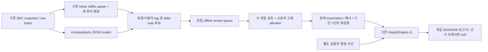

# SEC EvidenceAdapter v1

기존 SEC 원문과 재무 검토를 읽어 금리 노출 후보를 만들고, 독립 검토가 확인된 계약만 동결된 `financial_impact_v1`로 연결하는 별도 SHADOW 모듈이다. 원래 수집기·XBRL 파서·검토 정책·Impact 산식·예약 작업·가격 23요인·과거 평가를 수정하지 않는다. SEC 문장을 LLM 입력으로 보내지 않고 새 모델·유료 API·예약 작업을 추가하지 않는다.

## 경로와 계약



`SourceEvidence`, `ExposureCandidate`, `ContractTerms`, `ReviewBinding`, `VerifiedExposure`, `MissingEvidence`, `ExposureConflict`, `AdapterResult`를 `sec-evidence-adapter-v1`에 정의했다. Schema는 `contract.py`의 닫힌 객체이며 설명 없는 추가 필드를 받지 않는다. 값·통화·단위·범위·instrument·index·reset·hedge·기간을 모르면 null이다. 근거가 없는 0, 비율 1, USD, 헤지 없음으로 채우지 않는다. 확인된 재무 맥락과 계산 투입 계약 사실도 분리한다.

`catalog.py`는 원래 `sec_fact_review.view/state`의 CIK·공시·원문·연속 incarnation·amendment·검토 기록 검사를 재사용한다. `parsing.py`는 원래 `sec_filing_evidence`의 숫자/배율/부호/기간/기업/단위 파서와 `financial_fill.members`의 정확한 axis/member 추출을 재사용한다. 일반 재무 9항목의 assistant 검토나 XOM의 기존 매출 범위를 새 계약·독립 검토로 바꾸지 않는다.

## 원본과 변환 텍스트

SourceEvidence에는 CIK/ticker/accession/form/filed date, 원본 URL·source ID·원본 바이트 SHA-256·연속 incarnation·가용 시각·원문 경로를 보존한다. 공개시각이 날짜 정밀도뿐이면 precise `published_at`은 null이다. 파일 날짜를 자정의 공개시각으로 만들지 않는다.

원본 HTML은 실행하지 않는 UTF-8 바이트다. 변환 텍스트 SHA-256과 변환 방법 `sec-visible-chunks-codepoint-map-v1`은 별도로 기록한다. 각 텍스트 구간은 원본 code-point 위치에 연결된다. 정규화한 텍스트의 일부 인용과 이를 포함하는 원본 HTML 구간은 길이가 다를 수 있다. 그 원본 구간을 최소 인용문이라고 주장하지 않는다. 숫자는 원래 ix ordinal/DOM/context/row/scale/unit와 원본 span을 함께 보존한다. companyfacts는 정확한 JSON 경로를 보존한다.

PDF·비 UTF-8·지원하지 않는 숫자 표현은 자동으로 의미를 추정하지 않는다. 파싱 미지원은 부분 보고서로 구분하고, 원본/캐시 무결성 실패는 중단한다. 캐시 손상을 단순 자료 없음으로 숨기지 않는다. 보고서 재생은 캐시를 믿지 않고 원본에서 다시 파싱한다.

## 후보와 승격

차입·변동/고정금리·만기·금리·index·reset·hedge·원금·효력일을 tag/문구로 탐색한다. 이 분류는 **검색 힌트**다. 명시적 계약 값이나 VERIFIED의 근거가 아니다. custom tag와 표준 tag를 구분하며, 차원·숨겨진/다른 기업의 숫자와 미지원 형식은 보류한다.

총부채/유동부채→변동금리 원금, 만기→reset, 이자비용→원금, swap notional→정확한 hedge principal, 업종→노출은 금지한다. 회사 전체 companyfacts만으로 계약을 승격하지 않는다. 원금은 같은 기업·같은 공시의 정확한 적합 numeric witness에 있어야 하고, 계약별 해석은 별도 독립 검토가 필요하다. 장부가액과 실제 재설정 notional의 의미 차이도 검토자가 원문 계약으로 확인해야 한다.

상태는 DISCOVERED/SOURCE_BOUND/REVIEW_REQUIRED/VERIFIED/CONFLICTED/STALE/UNSUPPORTED/UNKNOWN이다. 원시 후보는 발견 기록으로 보존하고 실제 승인된 계약은 `verified_exposures`에 따로 둔다.

승격에는 다음 모두가 필요하다.

1. 현재 source incarnation·amendment 집합·방법 해시와 정확히 결합한 완성 리뷰.
2. 동일 계약·기간·통화·범위·실제 수치·원문 위치를 독립 검토한 서로 다른 두 사람.
3. 운영자가 독립성과 신원을 확인한 reviewer ID 및 review receipt hash의 고정 allowlist.
4. 두 검토의 같은 정규화 ContractTerms. 불일치·미해결·새 철회는 보류하며 이전 승인으로 돌아가지 않는다.
5. 원문·숫자·기간·단위·기업·계약·헤지·index와 최초 로컬 수신 시각 재검사. 개정/복원은 새 incarnation이며 옛 승인이 살아나지 않는다. 더 최근 금융 공시가 있으면 이전 공시의 계약 리뷰만으로 현재 노출을 승인하지 않는다.

기존 SEC 검토 정책은 일반 재무 항목용이고 독립 계약 검토 allowlist는 비어 있었다. 새 계약 receipt 형식은 그 검증·append-only 저장 패턴을 재사용하는 별도 supplement이며 기존 9항목 정책을 넓히지 않는다. 실제 독립 계약 기록이 없으면 기본 trust는 빈 목록이고 승격은 0이다. 소프트웨어는 사람의 판단이나 독립성을 만들지 않는다. 운영자가 검증한 신원/독립성은 오프라인 선언이며 이 체크섬이 암호학적 신원 인증은 아니다.

## Offline 검토 절차

티커 실행 시 `OFFLINE_REVIEW_QUEUE.private.json`에 원문/후보/locator와 미완성 manifest를 만든다. 사람을 배정하거나 승인하지 않은 양식은 완료/정답이 아니다. 두 평가자는 서로의 답과 모델 판정을 보지 않고 원문을 검토한다. 불일치는 제3자 조정과 독립 재검토 후 새로운 일치 리뷰로 해결하며 이전 파일을 고치지 않는다. 일반 서비스 사용자는 기사별 해석을 입력하지 않는다. 한 번 검토한 현재 계약은 반복 요청에서 자동 재사용한다.

각 manifest의 `terms`에는 `rate_type`, 기존 Impact `exposure`, 열 개 component `facts`, component별 candidate/raw span witness를 넣는다. 입력 facts와 exposure의 상태는 UNVERIFIED, `facts.review`는 null이어야 한다. manifest의 인간 검토가 이 정규화 값과 원본을 함께 다룬다. 값은 원문 witness 밖에서 임의 생성할 수 없고 원금은 원래 숫자와 Decimal로 같아야 한다.

```powershell
.\.venv\Scripts\python.exe -m extensions.sec_evidence_v1 --import-review reports/private/review-a.json --adapter-report reports/private/sec_evidence_v1/<UUID>
```

리뷰 파일은 `seal()` 형식의 record_sha256을 갖고, 수신 시점은 새 receipt로 최초 저장한다. 실제 검토 없이 이 명령을 실행해 승인을 만들지 않는다. 가져온 것만으로 자동 신뢰하지 않는다. 소유자는 두 리뷰 receipt 해시, 확인한 독립 reviewer ID, 별도로 승인한 경제 사건 review hash를 `sec-evidence-trust-v1` 파일에 고정한다. 실제 파일 경로와 그 바이트 SHA-256을 별도 CLI 인수로 제공한다.

`load_trust`는 처음 본 신뢰 정책의 로컬 가용 시각도 별도 불변 registry에 보존한다. 오래된 owner-declared 시각으로 승인 가용성을 소급하지 않는다. REAL 승인 보고서 재생에는 외부에서 다시 제공한 고정 trust가 필요하며 보고서 자체의 allowlist만 믿지 않는다. 같은 초의 수신·승인은 순서를 추정하지 않고 보류한다.

## ImpactEngine 연결

`bridge.py`는 저장된 계약을 다시 검증하고 원래 입력 schema와 Decimal 산식을 호출한다. 사용된 원문은 **전체 원본 UTF-8 HTML**과 원본 SHA-256이다. 2,000,000자 제한 등 동결된 Impact 계약에 맞지 않으면 보류하며 원문을 자르거나 변환 해시로 교체하지 않는다. 신규 evidence representation은 후속 별도 버전이 필요하다.

최초 승인 가용 시각은 원문·독립 리뷰 receipt·소유자 신뢰 정책의 가용 시각 중 최댓값이다. 이를 기존 Impact review 형식에 연결하는 `SEC_ADAPTER_BINDING_NOT_HUMAN`은 **기계적 provenance certificate**다. 사람이 새로 검토한 기록으로 표시하지 않는다. 원래 두 인간 receipt와 allowlist는 별도로 보존한다. Impact의 review hash allowlist와 fact hash 검증을 재사용한다.

경제 사건의 크기·index·통화·효력일이 별도로 검증되지 않으면 계약이 있어도 null이다. `--event-input`은 기존 Impact input 형식의 사건 전용 템플릿이며 issuer source/fact를 몰래 추가할 수 없다. index·통화·기간은 원래 Impact validator도 다시 검사한다. 여러 계약을 자동 합산하지 않고 필요하면 `--instrument-id`로 하나를 고른다. 동일 원금 witness를 다른 계약명으로 중복 승인할 수 없다.

## 자동 실행·캐시·선택적 취득

```powershell
.\.venv\Scripts\python.exe -m extensions.sec_evidence_v1 --tickers BE MSFT XOM
.\.venv\Scripts\python.exe -m extensions.sec_evidence_v1 --tickers BE BE MSFT --max-filings 4 --max-age-days 730
.\.venv\Scripts\python.exe -m extensions.sec_evidence_v1 --validate reports/private/sec_evidence_v1/<UUID>
.\.venv\Scripts\python.exe -m extensions.sec_evidence_v1 --tickers BE --trust-policy reports/private/owner-trust.json --trust-sha256 <SHA256> --event-input reports/private/event-input.json
.\.venv\Scripts\python.exe -m extensions.sec_evidence_v1 --validate reports/private/sec_evidence_v1/<UUID> --trust-policy reports/private/owner-trust.json --trust-sha256 <SHA256>
.\.venv\Scripts\python.exe -m pytest extensions/sec_evidence_v1/tests -q
```

모든 출력은 private 새 UUID이고 stdout은 상태·개수·경로만이다. CIK로 중복 제거하고 raw hash/CIK/파서/변환 코드 해시로 파싱 캐시를 재사용한다. 파싱 캐시는 파일당 32MB·총 256MB를 넘으면 저장을 건너뛰며 과거 파일을 삭제하지 않는다. 공시는 기존 검토 완료 사실, 저장 원문, 나머지 미수집 메타데이터 순으로 우선 선택한다. 기본 공시 cap 4(최대 8), 후보 cap 512, source/종류별 quota를 사용한다. 생략 수·미수집 원문·partial coverage를 보고하며 후보 수를 독립 성능 표본으로 세지 않는다.

기본 실행은 **SEC 요청 0회**다. 필요한 원문이 없으면 부분 보고서를 만든다. `acquisition.fetch_missing`은 기존 `sec_transport.Client.get`을 그대로 호출하는 최대 2개 URL의 선택적 연결 함수다. 기존 User-Agent·최소 간격·일일 예산·공유 잠금·HTTP 캐시/실패 기록을 재사용한다. 동일 URL은 한 번만 처리한다. 새로 받은 바이트는 기존 SEC snapshot collector에 등록돼야 계약 승격에 쓸 수 있으며 이 helper는 원래 registry를 고치지 않는다. 자동 상시 수집기·추가 예약 작업은 없다.

SEC API가 제공하는 전체 기업의 표준 taxonomy 집계와 회사 고유 tag/계약 주석은 범위가 다르다. [공식 SEC API 설명](https://www.sec.gov/search-filings/edgar-application-programming-interfaces)을 참고한다. 이 문서 확인은 실제 공시 다운로드/계약 검토 완료를 뜻하지 않는다.

SHADOW와 점수·목표가·추천 보류를 유지한다. 모델 정확도·주가 성능은 NOT_MEASURED이며 실제 독립 계약 검토가 없는 파일럿은 0개 승격이 정상이다. auto commit/push는 하지 않는다.
